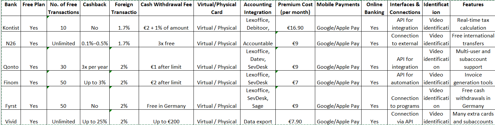
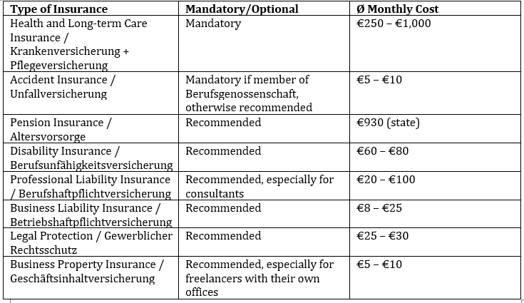

# Freelancer & Gewerbe Guide (EN)

Russian version: [Freelancer Gewerbe Guide (RU)](freelancer-gewerbe-guide.md)

**Last updated:** 18.11.2026. Registration, tax, insurance and hourly-rate sections received targeted corrections, several original examples and tips were restored, and Chapter 10 on AI in freelancing was added. On 02.05.2026: Internal links, external sources, and key 2026 tax figures were checked: Grundfreibetrag, Kinderfreibetrag, Kleinunternehmerregelung limits, filing deadlines, and baseline health-insurance parameters. Rules can change, so before filing or applying, verify the current requirements with Finanzamt, Ausländerbehörde, Krankenkasse, or a Steuerberater.

## Contents

- [Foreword](#foreword)
- [About the Author](#about-the-author)
- [Changelog](#changelog)
- [Chapter 1. Introduction](#chapter-1-introduction)
  - [Who are freelancers and Gewerbe owners in Germany?](#who-are-freelancers-and-gewerbe-owners-in-germany)
  - [Freelancer (Freiberufler)](#freelancer-freiberufler)
  - [Gewerbe (small business owners)](#gewerbe-small-business-owners)
  - [Key differences between a freelancer and a Gewerbe owner](#key-differences-between-a-freelancer-and-a-gewerbe-owner)
  - [Registration in Elster](#registration-in-elster)
  - [Fast Freiberufler registration](#fast-freiberufler-registration)
  - [Detailed registration](#detailed-registration)
  - [First 90 days checklist](#first-90-days-checklist)
- [Chapter 2. Taxes](#chapter-2-taxes)
  - [Types of taxes for freelancers and Gewerbe](#types-of-taxes-for-freelancers-and-gewerbe)
  - [VAT (Umsatzsteuer) and how to pay it](#vat-umsatzsteuer-and-how-to-pay-it)
  - [Tax optimization and limits for freelancers](#tax-optimization-and-limits-for-freelancers)
  - [Car for work](#car-for-work)
  - [Personal car used for work](#personal-car-used-for-work)
  - [Kinderfreibetrag: tax relief for parents](#kinderfreibetrag-tax-relief-for-parents)
  - [How to track expenses and keep receipts?](#how-to-track-expenses-and-keep-receipts)
  - [Simplified deductions (flat rates)](#simplified-deductions-flat-rates)
  - [Applying Kleinunternehmerregelung](#applying-kleinunternehmerregelung)
  - [Asset depreciation](#asset-depreciation)
  - [Applying the Europäische Kleinunternehmerregelung from 2025](#applying-the-europäische-kleinunternehmerregelung-from-2025)
  - [Tax calculator](#tax-calculator)
  - [Tax advisor](#tax-advisor)
- [Chapter 3. Accounting and invoices](#chapter-3-accounting-and-invoices)
  - [EÜR essentials](#eür-essentials)
  - [How EÜR works](#how-eür-works)
  - [Who must file EÜR?](#who-must-file-eür)
  - [How to create and submit EÜR](#how-to-create-and-submit-eür)
  - [What expenses can EÜR include?](#what-expenses-can-eür-include)
  - [Accounting software](#accounting-software)
  - [Invoicing](#invoicing)
  - [Invoicing outside the EU](#invoicing-outside-the-eu)
  - [Invoice template](#invoice-template)
  - [Invoicing via website and online platforms](#invoicing-via-website-and-online-platforms)
  - [Annual reporting](#annual-reporting)
  - [Common mistakes (quick link)](#common-mistakes-quick-link)
- [Chapter 4. Accounting software](#chapter-4-accounting-software)
  - [Accounting software overview](#accounting-software-overview)
- [Chapter 5. Banks](#chapter-5-banks)
  - [Overview of popular online banks for freelancers in Germany](#overview-of-popular-online-banks-for-freelancers-in-germany)
- [Chapter 6. Insurance](#chapter-6-insurance)
  - [Health and long-term care insurance (Krankenversicherung + Pflegeversicherung)](#health-and-long-term-care-insurance-krankenversicherung--pflegeversicherung)
  - [Accident insurance (Unfallversicherung)](#accident-insurance-unfallversicherung)
  - [Pension insurance (Altersvorsorge)](#pension-insurance-altersvorsorge)
  - [Künstlersozialkasse (KSK) for creative professions](#künstlersozialkasse-ksk-for-creative-professions)
  - [Disability insurance (Berufsunfähigkeitsversicherung)](#disability-insurance-berufsunfähigkeitsversicherung)
  - [Professional liability (Berufshaftpflichtversicherung)](#professional-liability-berufshaftpflichtversicherung)
  - [Insurance for foreigners](#insurance-for-foreigners)
  - [Business liability (Betriebshaftpflichtversicherung)](#business-liability-betriebshaftpflichtversicherung)
  - [Legal protection (Gewerblicher Rechtsschutz)](#legal-protection-gewerblicher-rechtsschutz)
  - [Business property insurance (Geschäftsinhaltsversicherung)](#business-property-insurance-geschäftsinhaltsversicherung)
  - [Insurance summary](#insurance-summary)
- [Chapter 7. Work](#chapter-7-work)
  - [Calculating your market rate](#calculating-your-market-rate)
  - [Where and how to find work (Kundenakquise für Freelancer)?](#where-and-how-to-find-work-kundenakquise-für-freelancer)
  - [Job loss and state support](#job-loss-and-state-support)
  - [Types of contracts for freelancers](#types-of-contracts-for-freelancers)
  - [Contract termination and sample letter](#contract-termination-and-sample-letter)
  - [False self-employment (Scheinselbstständigkeit)](#false-self-employment-scheinselbstständigkeit)
- [Chapter 8. Side gig as self-employed](#chapter-8-side-gig-as-self-employed)
  - [Combining with a main job](#combining-with-a-main-job)
  - [What is a self-employed side gig?](#what-is-a-self-employed-side-gig)
  - [Is freelancing as a side gig right for you?](#is-freelancing-as-a-side-gig-right-for-you)
  - [Registering as self-employed](#registering-as-self-employed)
  - [Tax specifics for part-time self-employment](#tax-specifics-for-part-time-self-employment)
  - [Social and health insurance](#social-and-health-insurance)
  - [Side gig limitations](#side-gig-limitations)
  - [Employer notice template for a Nebentätigkeit (in German)](#employer-notice-template-for-a-nebentätigkeit-in-german)
  - [Pros and cons of a side gig](#pros-and-cons-of-a-side-gig)
  - [Legal aspects of a side gig](#legal-aspects-of-a-side-gig)
- [Chapter 9. Freelance visas](#chapter-9-freelance-visas)
  - [Visa requirements](#visa-requirements)
  - [Application process](#application-process)
  - [Documents for foreigners](#documents-for-foreigners)
  - [Visa extension](#visa-extension)
- [Chapter 10. AI in freelancing: Claude, Codex and GDPR](#chapter-10-ai-in-freelancing-claude-codex-and-gdpr)
  - [Where AI genuinely helps](#where-ai-genuinely-helps)
  - [Personal or business plan: who processes your data](#personal-or-business-plan-who-processes-your-data)
  - [GDPR: when your work involves clients' personal data](#gdpr-when-your-work-involves-clients-personal-data)
  - [Contracts, NDAs and professional secrecy](#contracts-ndas-and-professional-secrecy)
  - [EU AI Act: what applies to freelancers](#eu-ai-act-what-applies-to-freelancers)
  - [Taxes and bookkeeping for AI subscriptions](#taxes-and-bookkeeping-for-ai-subscriptions)
  - [Experimental: German Business Kit](#experimental-german-business-kit)
- [Useful resources](#useful-resources)
- [Freelancer communities in Germany](#freelancer-communities-in-germany)
- [Quick glossary](#quick-glossary)
- [FAQ (short)](#faq-short)
- [10 common mistakes](#10-common-mistakes)
- [Freiberufler vs Gewerbe vs employee with side gig](#freiberufler-vs-gewerbe-vs-employee-with-side-gig)
- [Conclusion](#tax-advisor-summary)

## Foreword

Freelancing in Germany is a varied and flexible path that can be ideal if you value freedom of choice, independence, and control over your schedule. Every step toward freelancing is a personal decision shaped by your personality, skills, and the local job market.

Some people enjoy working solo, taking ownership of projects, and managing their own time. Others want a steadier schedule and a predictable flow of tasks from regular clients. Freelancing is not just freedom from office routines; it means owning every part of your business: finding clients, signing contracts, and staying compliant with tax and legal rules.

Freelancing in Germany follows clear rules, whether you register as a free profession (Freie Berufe) or as a Gewerbe (sole proprietor). Each path has its own specifics and bureaucracy. The transition can be inspiring and challenging, especially if you’re not ready for admin, tax obligations, and self-management.

With solid preparation, freelancing in Germany can be a key to professional freedom and growth. It opens opportunities, but demands a clear understanding of the landscape and a willingness to keep improving.

“Do I even need this?” you might ask between gigs. German tax advisors will gladly help you for €200/hour, and when a client says they want a “paid pause,” you realize the risks sit on your shoulders—no sick leave, no vacation pay, no 13th salary. Just you, your laptop, and your taxes.

So, is it for you? If you love adventure, the German language, and bureaucracy—yes. If not, maybe staying an employee is the more comfortable choice.

## About the Author

Hi! I’m Ilya Fedotov. I’ve lived in Germany for nine years. I worked as a full-time freelance IT specialist for more than three years and now work full-time in an office job. I have 20+ years of experience as a Microsoft Solution Architect and have worked on large migration and infrastructure projects for companies like Deutsche Bank, Fujitsu Services and Infosys.

In my spare time I founded a small start-up, [Uverna](https://getuverna.com): an AI assistant for the whole job search. It helps you find jobs in Germany and across Europe, prepare your CV and cover letters, and keep your applications in one place. The interface is available in German, English, Ukrainian and Russian, and you send your applications to employers yourself. Early access is open.

In this guide I share my path into freelancing, from registration to annual reporting and finding clients. It’s based on my own experience in Germany; use it to avoid common pitfalls. I’m not a financial advisor or accountant, so everything you do based on this text is at your own risk (“you’ve been warned” 😊).

If you need a freelance visa, start with [Chapter 9](#chapter-9-freelance-visas): you need to sort that out before registering as a freelancer in Germany. That’s just the start of the fun.

Questions or feedback? Email fedotov.ilya (at) gmail.com or reach out on [LinkedIn](https://www.linkedin.com/in/fedotovi/).

## Changelog

| **Change** | **Page** | **Date** | **Comments** | **Author** |
|----|:--:|:--:|:--:|:--:|
| Chapter 10: AI in freelancing | Chapter 10 | 18.11.2026 | Claude and Codex plans and training, GDPR and AVV, NDAs and § 203 StGB, AI Act, reverse charge for subscriptions, German Business Kit (preview) | Ilya |
| Legal and tax corrections, restored examples | Entire document | 18.11.2026 | Freiberufler vs Gewerbe, §141 AO, VAT periods (2027 start-ups), trade tax credit, car VAT example, KUR invoice note, retention, accident insurance, hourly rate, status comparison table | Ilya |
| 2026 tax figures and filing section update | Entire document | 02.05.2026 | Grundfreibetrag, Kinderfreibetrag, KUR, insurance contributions, filing deadlines, ELSTER forms by status | Ilya |
| TL;DR, tax/insurance tables, FAQ/glossary | Entire document | 22.11.2025 | Added quick blocks, tax/status tables, FAQ/10 mistakes | Ilya |
| Retention tables, platform/FX cases | Entire document | 22.11.2025 | GoBD with HR/tech docs; Upwork/Stripe numeric examples | Ilya |
| Voranmeldung examples + BMF links | Taxes section | 22.11.2025 | §18 UStG examples, Grundtabelle link | Ilya |
| Mandatory e-invoice receipt (contents TL;DR + side gig note) | Entire document | 22.11.2025 | B2B receipt required from 2025; PDF ≠ e-invoice | Ilya |
| Tax clarifications (GewSt min, §35 credit, KUR downsides, EV 0.25% €100k, Kinderfreibetrag, TOC) | Entire document | 22.11.2025 | Gewerbesteuer min Hebesatz/§35 credit; Ist-Versteuerung for Freiberufler; KUR no input VAT + 5-year lock; EV 0.25% up to €100k; Kinderfreibetrag/Günstigerprüfung; TOC refreshed | Ilya |
| Europäische Kleinunternehmerregelung from 2025 | 32 | 08.01.2025 | 2025 updates | Ilya |
| E-Rechnungspflicht | 42 | 08.01.2025 | 2025 updates | Ilya |
| Neue Kleinunternehmerregelung 2025 | Entire document | 08.01.2025 | 2025 updates | Ilya |
| Entlastung bei der Umsatzsteuervoranmeldung 2025 | Entire document | 08.01.2025 | 2025 updates | Ilya |
| Erhöhung des Grundfreibetrags | Entire document | 08.01.2025 | 2025 updates | Ilya |
| Document update, revision 4 | Entire document | 19.01.2025 |  | Ilya |
| Document update, revision 2 | Entire document | 19.09.2024 |  | Ilya |
| Document update, revision 2 | Entire document | 15.09.2024 |  | Ilya |
| Document update, revision 1 | Entire document | 13.09.2024 |  | Ilya |
| Document created | Entire document | 10.09.2024 |  | Ilya |

## Chapter 1. Introduction

The overall registration flow looks roughly like this:


### Who are freelancers and Gewerbe owners in Germany?

In everyday English, “freelancer” can describe anyone who works for clients on their own account. In Germany, registration depends on the work itself. A freelancer may practise a liberal profession (freiberufliche Tätigkeit) or run a commercial business (Gewerbe).

### Freelancer (Freiberufler)

Doctors, architects and translators are examples of the liberal professions. Independent teaching also qualifies. If you work in IT, describe what you actually deliver and what qualifications the work requires. Designing a complex system and repairing computers are quite different activities, even if both specialists introduce themselves as IT freelancers. [§ 18 EStG](https://www.gesetze-im-internet.de/estg/__18.html)

Individuals practising only a liberal profession generally do not need registration in the Handelsregister or membership of the local chamber of commerce and industry (Industrie- und Handelskammer, IHK). Members of regulated professions may have their own professional chamber. But not every activity will be accepted as “freelance.” To check if you can be a Freiberufler, review the IHK guidance: [<u>https://www.ihk.de/magdeburg/recht/allgemeine-rechtsauskuenfte-1/gewerberecht-ordner/gewerbeordnung/freier-beruf/abgrenzung-gewerbe-und-freier-beruf-1717318</u>](https://www.ihk.de/magdeburg/recht/allgemeine-rechtsauskuenfte-1/gewerberecht-ordner/gewerbeordnung/freier-beruf/abgrenzung-gewerbe-und-freier-beruf-1717318)

### Gewerbe (small business owners)

Imagine opening a shop, selling goods or running a repair service on your own. Those are typical examples of a Gewerbe. You notify your local Gewerbeamt when you start. Entry in the commercial register (Handelsregister) is a separate step. For a sole proprietor with a small shop it is generally voluntary, but it becomes mandatory when the nature or scale of the business requires commercial organisation. [§ 14 GewO](https://www.gesetze-im-internet.de/gewo/__14.html) · [§ 1 HGB](https://www.gesetze-im-internet.de/hgb/__1.html)

Both kinds of business can grow and hire. An architect can bring a colleague into the practice to work on drawings. To retain Freiberufler status, the architect must continue to direct the professional work and take personal responsibility for it using their own expertise. [§ 18 EStG](https://www.gesetze-im-internet.de/estg/__18.html)

So where do you start? Describe your first project the way you would explain it to the client. What will you do, what will you hand over, and what are you being paid for? With that description it is much easier to fill in the Finanzamt questionnaire and to sort out a borderline case.

### Key differences between a freelancer and a Gewerbe owner

One practical difference is trade tax. Income from a liberal profession is outside Gewerbesteuer. A sole trader or partnership has a €24,500 annual allowance against Gewerbeertrag, the trade earnings after tax adjustments. A workshop with €30,000 of trade earnings therefore has €5,500 left for the calculation. [§ 11 GewStG](https://www.gesetze-im-internet.de/gewstg/__11.html)

What about bookkeeping? A small workshop can also use simple cash-basis accounts (Einnahmenüberschussrechnung, EÜR) if the owner has no duty to keep full books and does not keep them voluntarily. So the question of long evenings over spreadsheets has a very concrete answer: which requirements apply to your business, and which documents will you need for the tax return?

Registration also varies by activity and region, so review local guidance:

[<u>https://www.lexware.de/wissen/gruendung/gewerbe-anmelden/</u>](https://www.lexware.de/wissen/gruendung/gewerbe-anmelden/)

[<u>https://www.ihk.de/karlsruhe/fachthemen/recht/gewerberecht/gewerbeanmeldung-4632354</u>](https://www.ihk.de/karlsruhe/fachthemen/recht/gewerberecht/gewerbeanmeldung-4632354)

If you offer several things, describe each activity separately. Developing software for a client and selling hardware may need different accounting treatment. It is easier to settle that before the first invoice, while you can still explain exactly what the customer is buying.

So you don’t pick Freiberufler or Gewerbe like a tariff plan: your work decides. Gewerbe isn’t automatically “hard mode” either, because a small Gewerbe can keep the same simple EÜR. The real extras are the Gewerbeamt notification, IHK membership and, above the allowance, trade tax. Freelancing has its own sharp edges: Finanzamt may not accept your activity as a liberal profession, so describe it carefully.

### Registration in Elster

**Prerequisite:** You need access to Mein ELSTER, the online portal for communicating with your tax office (Finanzamt). ELSTER stands for elektronische Steuererklärung, or electronic tax return. There you submit your freelance application, communicate with the tax office, file returns, and grant access to a Steuerberater. Steps:

1. Go to [<u>https://www.elster.de/eportal/start?themaGlobal=help_registrierung</u>](https://www.elster.de/eportal/start?themaGlobal=help_registrierung)

2. Click **Next**


3. Click **Next**


4. Choose **Certificate file** and click **Select**


5. Select **For me ( and my partner)** and click **Next**


6. Choose **With tax identification number**


7. Enter your data in **Data Entry**, tick **I confirm**, and click **Next**


8. Fill **Pre-filling the income tax return**:

If you want to share this account with your spouse/children, add their tax IDs here. Elster stores the data you provide and can prefill core forms next year. You can edit changes later; this saves time and shows what you filed previously. Click **Check** to review before submitting.


9. Registration confirmation

If everything is filled (grey fields), click **Submit**. You’ll get an email to confirm the data—click the activation link (valid for 7 days; check spam). Then you’ll receive a second letter with activation instructions and an activation ID—save it.


10. Registration in **Elster Online**

When the second activation code arrives (up to ~14 days; contact support if not), complete registration. You’ll need the saved certificate plus login/password to access later.

A dedicated account makes it easier to distinguish customer payments from personal spending. For a sole proprietor, check that the account terms permit business use. See Chapter 5, Banks.

### Fast Freiberufler registration

Note: not an ad for getsorted. The screenshots show the workflow when this guide was prepared. Button names may differ today.

1. Sign up at [<u>https://en.getsorted.de</u>](https://en.getsorted.de)

2. On the homepage, click **Start registration**


3. Fill the **Personal Details** form. Be sure to specify your profession.

4. Fill in **Business Info.** Describe your profession and the work you do for clients. Finanzamt assesses your activity using these details. The software selection alone does not settle your status.


5. **Tax Setup.** Under **Profit determination method**, choose single-entry bookkeeping if you use EÜR. Select the balance-sheet method if that is how you keep your books. For a commercial business, turnover over €800,000 or profit over €80,000 can trigger a bookkeeping obligation following notice from Finanzamt under §141 AO. That rule does not apply to income from a liberal profession. [§ 141 AO](https://www.gesetze-im-internet.de/ao_1977/__141.html)

6. **Tax Estimation.** Enter your freelance status and expected income for the current and next year (details vary per situation).

**Bank Account.** Enter the international bank account number (IBAN) you will use for business. If you have opened a dedicated account, use its details here.


7. **Review and Submit.** Choose your local Finanzamt office and click **Submit to the Finanzamt**.

### Detailed registration

Detailed registration means logging into **Elster** and completing the online form **Fragebogen zur steuerlichen Erfassung**.

Recommended walk-through videos:

- Russian: **Tupa Germania**:

[<u>https://www.youtube.com/watch?v=S9eyTPUcp1s</u>](https://www.youtube.com/watch?v=S9eyTPUcp1s)

- German: **Steuerfit**:

[<u>https://www.youtube.com/watch?v=Uqe_tQvaILg&t=1s</u>](https://www.youtube.com/watch?v=Uqe_tQvaILg&t=1s)

**Gewerbe registration videos (German)**

For Bavaria

[Gewerbe anmelden - Gewerbeschein beantragen: Schritt-für-Schritt Anleitung für Anfänger](https://www.youtube.com/watch?v=nm4kTkUa-44)

For Berlin

[Gewerbe anmelden - Gewerbeanmeldung ausfüllen: Schritt für Schritt Anleitung 2023](https://www.youtube.com/watch?v=trPRRPUjpNQ)

Depending on your location and processing times, within 2–9 weeks you’ll get confirmation of freelance registration for your activity plus your tax number.

### First 90 days checklist

1. Choose an account for business payments and confirm that your bank permits that use.
2. Register in Elster and keep the certificate file safe.
3. Complete the tax registration questionnaire (Fragebogen zur steuerlichen Erfassung). State whether you will use the small-business exemption from value added tax (Kleinunternehmerregelung, KUR) or the standard VAT rules.
4. Set up your cash-basis bookkeeping (EÜR). Decide where you will keep receipts and original electronic invoices. The German principles governing digital bookkeeping and record retention are known as GoBD.
5. Minimum insurance: health; consider liability (Haftpflicht) and disability (Berufsunfähigkeit).
6. Prepare invoice templates for customers in Germany, elsewhere in the EU and outside the EU.
7. Issue your first invoice and verify banking/VAT wording (§19 UStG if applicable).

<a id="2-taxes"></a>

## Chapter 2. Taxes

Taxes are a mandatory “quest” for every freelancer or small business in Germany. Not the most fun, but skipping it brings fines and tax-office questions. This chapter covers the core taxes freelancers and Gewerbe owners must handle to stay legal and sleep well.

**Tax essentials:**
- Confirm status (Freiberufler vs Gewerbe) and whether Gewerbeamt is required.
- **KUR.** In the start year, the KUR ceiling is €25,000 of actual qualifying turnover. In later years, the limits are €25,000 in the previous year and €100,000 in the current year, both inclusive.
- Voranmeldung usually follows the prior year’s VAT liability. Over €9,000 means monthly filing, otherwise quarterly. At €2,000 or less, Finanzamt may waive prefilings. [§ 18 UStG](https://www.gesetze-im-internet.de/ustg_1980/__18.html)
- Income tax is progressive: the 2026 Grundfreibetrag is €12,348, then rates progress up to 42/45%.
- International: ordinary services supplied to a business customer in another EU country (business-to-business, B2B) generally use reverse charge: the customer accounts for the VAT. For ordinary B2B services to non-EU customers, the place of supply is generally outside Germany. [§ 3a UStG](https://www.gesetze-im-internet.de/ustg_1980/__3a.html)

### Types of taxes for freelancers and Gewerbe
#### Tax overview (quick table)

| Tax | Base | Who pays | Key thresholds/rates | When to file/pay | Notes |
| --- | --- | --- | --- | --- | --- |
| Income tax (ESt) | Taxable income | Individuals with taxable income | 2026 Grundfreibetrag: €12,348; progressive to 42/45% | Annual return; quarterly advances if assessed | Formulas: Grundtabelle published by the Federal Ministry of Finance (BMF) |
| VAT (USt) | Turnover | Everyone unless KUR | KUR ≤€25k prior, ≤€100k current; start year ≤€25k; Voranmeldung monthly if VAT owed > €9k | Voranmeldung monthly/quarterly; annual return | Vorsteuerabzug if not on KUR |
| Trade tax (GewSt) | Adjusted trade profit (Gewerbeertrag) | Commercial businesses | €24,500 allowance for sole proprietors and partnerships; 3.5% × municipal Hebesatz | Annual return if required | Check Hebesatz: e.g., <https://www.hebesatzdatenbank.de/> |
| Solidarity surcharge (Soli) | Add-on to ESt | High earners | Based on ESt amount | With ESt | --- |
| Church tax | Add-on to ESt | If registered church member | 8–9% of ESt | With ESt | --- |

Hebesatz calculators by state: <https://www.hebesatzdatenbank.de/> (filter by Bundesland).
Formulas/refs: income tax (Grundtabelle BMF), VAT (§§18, 19 UStG), trade tax (§11 GewStG; calculator <https://bmf-steuerrechner.de/gewst/>), solidarity surcharge (BMF info page).

#### 1. Income tax (Einkommensteuer)

**Important:** the tax amounts and thresholds below were updated for 2026, but the final requirements depend on your situation. Before decisions on VAT, Kleinunternehmerregelung, EÜR, or deductions, verify the rules with Finanzamt or a Steuerberater.

Freelancers and Gewerbe owners pay income tax like other taxpayers. Your business profit contributes to taxable income along with any other income and applicable deductions (figures are for 2026).

- Up to €12,348/year: 0% (Grundfreibetrag).
- €12,349–€17,799: first progression zone, entering at about 14%.
- €17,800–€69,878: second progression zone, gradually rising to 42%.
- €69,879–€277,825: 42%.
- From €277,826: 45%.

Example: at €80,000 of taxable income in 2026, the basic single-person tariff yields €22,464 of income tax, about 28.1% overall before any solidarity surcharge or church tax. The marginal rate at that income is 42%. [§ 32a EStG](https://www.gesetze-im-internet.de/estg/__32a.html)

- Formulas/Grundtabelle BMF: <https://www.bmf-steuerrechner.de/>

The screenshot below uses the 2024 tariff to illustrate the difference between the average and marginal rate.


#### 2. VAT (Umsatzsteuer)

Most freelancers and Gewerbe owners must charge VAT (Mehrwertsteuer/Umsatzsteuer). The standard rate in Germany is 19%; some items like books and many foods use a reduced 7% rate. Exception: Kleinunternehmer: from 2025 the national thresholds are up to €25,000 turnover in the previous calendar year and up to €100,000 in the current year. The start-year ceiling is €25,000.

#### 3. Trade tax (Gewerbesteuer)

Income from a liberal profession is outside trade tax. For a commercial sole proprietor, start with adjusted trade profit (Gewerbeertrag) and subtract the €24,500 allowance. Apply the 3.5% measurement rate and the local Hebesatz. The statutory minimum Hebesatz is 200% through 2026 and 280% from 2027. The income-tax credit is capped at four times the measurement amount, the actual trade tax and the portion of income tax attributable to commercial income. In practice, the effective rate is roughly 7–31.5% (at least 9.8% from 2027). Paid trade tax is credited against income tax, often fully up to a Hebesatz of about 400%, so the net burden rises less than the paperwork. [§ 11 GewStG](https://www.gesetze-im-internet.de/gewstg/__11.html) · [BMF](https://www.bundesfinanzministerium.de/Content/DE/Glossareintraege/G/gewerbesteuer.html?view=renderHelp) · [§ 35 EStG](https://www.gesetze-im-internet.de/estg/__35.html)

<a id="4-cooperative-and-corporate-taxes"></a>

#### 4. Corporate tax (Körperschaftsteuer)

Freelancers do not pay corporate tax (Körperschaftsteuer); it applies to Kapitalgesellschaften like GmbH, AG, or UG—not to “capital investments” themselves. Private investment income is taxed separately (Abgeltungsteuer), outside this guide.

### VAT (Umsatzsteuer) and how to pay it

VAT applies to most goods/services in Germany. Two main methods matter: **Soll-Versteuerung** and **Ist-Versteuerung**.

<a id="1-soll-versteuerung-vat-due-on-invoice-date"></a>

#### 1. Soll-Versteuerung (VAT based on when you perform the service)

VAT normally arises at the end of the filing period in which you perform the service, even if you invoice later or the client has yet to pay. An advance payment triggers VAT on the amount received in that period. You may therefore have to pay VAT before the client settles the invoice. [§ 13 UStG](https://www.gesetze-im-internet.de/ustg_1980/__13.html)

#### 2. Ist-Versteuerung (VAT due on payment date)

With Finanzamt approval, VAT arises at the end of the filing period in which you receive payment. That can help with cash flow. You can apply if your total turnover in the prior calendar year was at most €800,000. Qualifying liberal-profession turnover has a separate route without that ceiling if you keep no books for those sales. [§ 20 UStG](https://www.gesetze-im-internet.de/ustg_1980/__20.html) · [UStAE 20.1](https://lsth.bundesfinanzministerium.de/usth/2024/A-Umsatzsteuergesetz/V-Besteuerung/Paragraf-20/inhalt.html)

#### 3. VAT prefilings (Umsatzsteuer-Voranmeldung)

Under the regular VAT filing rules, the prior year’s VAT liability normally determines the filing period. For 2026, use expected VAT liability if you start that year. If you operated for only part of 2025, convert the actual 2025 liability to an annual amount. That special rule covers 2021–2026 only: unless it is extended, a business that starts in 2027 or later files monthly in its first and second calendar years. [§ 18 UStG](https://www.gesetze-im-internet.de/ustg_1980/__18.html)

- If prior-year VAT liability **> €9,000**: file monthly.
- If **over €2,000 and up to €9,000**: file quarterly.
- If **€2,000 or less**, Finanzamt may waive prefilings. The annual VAT return is a separate filing. [§ 18 UStG](https://www.gesetze-im-internet.de/ustg_1980/__18.html)

Note: thresholds refer to VAT **amount owed**, not your turnover.

File by the 10th of the month following the period.

Official thresholds are in §18 UStG and use the prior-year VAT owed. Example: prior-year VAT €3,600 → quarterly in the next year (~€900/quarter). Prior-year VAT €12,000 → monthly (~€1,000/month).

**Numeric example:** prior-year VAT €4,500 → falls into the €2k–€9k band → quarterly prefiling. Roughly budget ~€1,125 per quarter (actual depends on current turnover), but the filing period stays quarterly.

------------------------------------------------------------------------

#### 4. Advance tax payments

Freelancers and Gewerbe make advance income-tax payments (Vorauszahlungen) to avoid a big year-end bill. Payments are set from your estimated income at registration or last year’s income.

<a id="1-how-are-advance-payments-calculated"></a>

##### How are advance payments calculated?

After registering, declare your expected annual income (**Einkommensteuervorauszahlung**). The tax office calculates quarterly advance payments, due:

- 10 March,

- 10 June,

- 10 September,

- 10 December.

You learn the final income tax after year-end, so advances spread the cost. If your expected income changes, you can request an adjustment.

<a id="2-recalculation-and-final-tax-payment"></a>

##### Recalculation and final tax payment

After year-end you file the final return. If advances exceed the final assessed tax, you get a refund. **Set money aside for these payments to avoid surprises.**

If you underpaid, you must pay the balance within a month of the assessment.

------------------------------------------------------------------------

### Tax optimization and limits for freelancers

Optimizing tax burden matters: anything tied to your professional activity and documented can reduce taxable income. Keep all receipts and watch filing deadlines. Not all expenses are fully deductible; some have limits. Below: what you can deduct and how to stay compliant.

#### What is an expense deduction?

Expense deduction reduces taxable income by accounting for business costs. Example: a work laptop can be deducted. Deductions lower the tax you owe.

#### Which expenses are fully deductible?

Fully deductible = 100% counts against income. Examples: office rent, supplies, insurance, professional advice, some travel.

Examples:
- **Office rent (Büromiete):** A dedicated workspace is fully deductible.
- **Office supplies (Bürobedarf):** Paper, pens, folders, and similar work materials.
- **Insurance (Versicherungen):** Professional liability and legal protection policies tied to the business.
- **Advisory (Beratungskosten):** Tax/accounting advice and other legal services.

#### Which expenses are partially deductible?

Partially deductible = only a portion counts, often because there’s a personal element.

Examples:
- **Client entertainment (Bewirtungskosten):** Deduct 70% of reasonable and documented business entertainment costs, net of any recoverable VAT. With input VAT rights and proper documentation, you can generally reclaim the full VAT on reasonable business entertainment. Under Kleinunternehmerregelung you cannot reclaim input VAT, so the VAT stays part of the cost and 70% of the gross amount is deductible. [§ 4 EStG](https://www.gesetze-im-internet.de/estg/__4.html) · [§ 15 UStG](https://www.gesetze-im-internet.de/ustg_1980/__15.html)
- **Personal car used for work:** Deduct only the business-use share; personal use is not deductible.

<a id="which-expenses-are-vat-only-deductible"></a>

#### Which expenses involve input VAT and depreciation?

For purchases such as equipment or vehicles, claim input VAT separately if you are entitled to it. The purchase cost itself may be deducted over time via depreciation (Absetzung für Abnutzung, AfA). [§ 15 UStG](https://www.gesetze-im-internet.de/ustg_1980/__15.html) · [§ 7 EStG](https://www.gesetze-im-internet.de/estg/__7.html)

#### Limits on deductions

Some costs have caps or are non-deductible, for example:

- **Client gifts (Geschenke an Kunden):** If gifts to the same recipient cost more than €50 in total over the financial year, none of those gifts are deductible. [§ 4 EStG](https://www.gesetze-im-internet.de/estg/__4.html)

- **Meals on business trips (Verpflegungsmehraufwendungen):** Within Germany, the allowance is €14 for a same-day trip of more than 8 hours or for the arrival and departure days of an overnight trip, and €28 for each full calendar day away. Foreign rates can differ. [§ 4 EStG](https://www.gesetze-im-internet.de/estg/__4.html) · [§ 9 EStG](https://www.gesetze-im-internet.de/estg/__9.html)

#### How to optimize taxes?

1. **Track all expenses.** Keep every receipt tied to your work.
2. **Use depreciation for big purchases.** You can spread equipment costs over its useful life. For eligible computer hardware and software, you can generally deduct the full amount in the acquisition year under the BMF’s one-year useful-life guidance. [AfA tables](https://www.bundesfinanzministerium.de/Datenportal/Daten/offene-daten/steuern-zoelle/afa-tabellen/AFA-Tabellen.html) · [BMF computer guidance](https://esth.bundesfinanzministerium.de/esth/2022/C-Anhaenge/Anhang-01/V/anhang-1-V.html)
3. **Separate personal vs business use.** For car/phone/computer, track business share to avoid audit issues.
4. **Consult a tax pro.** A Steuerberater helps allocate expenses and optimize legally.

#### Expense table

The table is an older illustration of common expenses. Use the rules above to check separately how much you can deduct from profit and how much input VAT you can reclaim.

| Type of Expenses | Full Deduction | VAT Deduction Only |
| --- | --- | --- |
| Office Expenses | Yes (Ja) | \- |
| Office Rent | Yes (Ja) | \- |
| Office Furniture | Yes (Ja) | \- |
| Office Supplies | Yes (Ja) | \- |
| Virtual Office | Yes (Ja) | \- |
| Technical Equipment | Yes (Ja) | Only VAT, if subject to depreciation |
| Computers | Partially (according to depreciation/AfA) | Yes (on purchase) |
| Software | Yes (Ja) | \- |
| Transport Costs | \- | Yes (VAT on transport costs) |
| Personal Vehicles for Work Purposes | Partially (according to depreciation/AfA) | Yes (if VAT was paid at purchase) |
| Travel Tickets | Yes (Ja) | \- |
| Business Travel Expenses | Yes (Ja) | \- |
| Meals on Business Trips | Partially (according to flat-rate rules) | \- |
| Work Materials | Yes (Ja) | \- |
| Office Supplies (again) | Yes (Ja) | \- |
| Professional Literature | Yes (Ja) | \- |
| Representation Expenses | Partially (70%) | Yes (full VAT) |
| Gifts to Clients | Not deductible if over €50 | \- |
| Depreciation (AfA) | Partially (according to depreciation/AfA) | \- |
| Business Insurance | Yes (Ja) | \- |
| Accounting and Consulting Services | Yes (Ja) | \- |
| Marketing Services | Yes (Ja) | \- |

### Car for work

Using a business car privately creates a **taxable benefit (geldwerter Vorteil)**. Two methods are allowed to calculate private use: **logbook method (Fahrtenbuchmethode)** and **1% method (1-Prozent-Methode)**. Below: how they work and what to consider.

#### Input VAT on car expenses

- Input VAT on car costs such as fuel, repairs and maintenance depends on your right to deduct it and how the car is allocated for VAT purposes. A vehicle used less than 10% for the business cannot be allocated to it for input VAT on the purchase. [§ 15 UStG](https://www.gesetze-im-internet.de/ustg_1980/__15.html) · [UStAE 15.23](https://www.bundesfinanzministerium.de/Content/DE/Downloads/BMF_Schreiben/Steuerarten/Umsatzsteuer/Umsatzsteuer-Anwendungserlass/Umsatzsteuer-Anwendungserlass-31-12-2025.pdf?__blob=publicationFile&v=3)
- Example: if all €9,450 of costs include VAT at 19% and qualify for full deduction, the amounts are about €7,941 net and €1,509 deductible VAT.

#### VAT on private use

- Private use of a vehicle allocated fully to the business can trigger VAT where the purchase gave rise to input VAT deduction. Use the VAT valuation rules for private use. Example using a logbook and an assumed taxable cost base. [UStAE 15.23](https://www.bundesfinanzministerium.de/Content/DE/Downloads/BMF_Schreiben/Steuerarten/Umsatzsteuer/Umsatzsteuer-Anwendungserlass/Umsatzsteuer-Anwendungserlass-31-12-2025.pdf?__blob=publicationFile&v=3)
  - €7,941 net costs × (5,000 km / 24,500 km) = €1,620.61 private use (net amount)
  - €1,620.61 × 19% = €307.92 VAT to pay back.

#### 1. Logbook method (Fahrtenbuchmethode)

You must record every business trip with:
- Date
- Start/end points
- **Odometer readings** at start and end
- **Purpose** and client/partner name if relevant

##### Advantages of the logbook method

- Good if private use is rare, so taxable private share stays minimal.
- If the car is old/fully depreciated, logbook is often better than the 1% method.

<a id="disadvantages"></a>

##### Disadvantages of the logbook method

- Requires careful, regular records; gaps can lead the tax office to reject the method.
- Manual logbooks are tedious; GPS/app solutions can ease the process.

#### 2. 1% method (1-Prozent-Methode)

This method values private use at **1% of the car’s original gross list price** per month. For self-employed taxpayers it applies only if the car is used more than 50% for business. A reduced basis can apply to eligible electric vehicles and plug-in hybrids. [§ 6 EStG](https://www.gesetze-im-internet.de/estg/__6.html)

##### Advantages of the 1% method

- Simple; no logbook needed.
- Convenient if private use is frequent or the car is new/high list price.

<a id="disadvantages-1"></a>

##### Disadvantages of the 1% method

- For older cars it can be worse, since it uses original list price, not current value.
- Private-use tax can be high, especially if personal trips are rare.

<a id="example-calculation"></a>

#### Example calculations: logbook vs 1% method

##### Example calculation with logbook method

Suppose total car costs are €9,450/year. You drove 24,500 km, of which 19,500 km were business and 5,000 km private.

- *€9,450 × (5,000 km / 24,500 km) = **€1,928.57** is the private-use amount for income tax.*

##### Example calculation with 1% method

If the car’s gross list price is €35,000, the 1% method gives:

*€35,000 × 1% × 12 months = €4,200 as the private-use amount.*

#### 3. Adjustments: commuting to first workplace

Under the 1% method, the flat calculation for trips between home and your first business location uses 0.03% of the gross list price per month per one-way kilometre. For a 10 km commute in a car with a €35,000 list price over 12 months, the calculation is as follows. [§ 4 EStG](https://www.gesetze-im-internet.de/estg/__4.html)

- *€35,000 × 0.03% × 10 km × 12 months = **€1,260**.*

The positive difference between this amount and the commuter allowance (Entfernungspauschale) is nondeductible. From 2026, the allowance is €0.38 per full one-way kilometre from the first kilometre, for days you travel to that location. [§ 4 EStG](https://www.gesetze-im-internet.de/estg/__4.html) · [§ 9 EStG](https://www.gesetze-im-internet.de/estg/__9.html)

#### 4. Tax benefits for EVs

EVs and plug-in hybrids have special relief for income tax. The **0.25%** rate for eligible zero-emission cars uses a gross list-price ceiling of €100,000 for acquisitions from 1 July 2025 through 2030. For earlier acquisitions, check the lower ceiling that applied to the acquisition date. [§ 6 EStG](https://www.gesetze-im-internet.de/estg/__6.html) · [BMF guidance](https://esth.bundesfinanzministerium.de/lsth/2026/B-Anhaenge/Anhang-24/IV/IV-6/inhalt.html)

##### EV calculation example

Example: EV list price €52,000 bought in 2020. At 0.25%:

- *(€52,000 × 0.25%) × 12 months = **€1,560**.*

<a id="conclusion-choosing-between-logbook-and-1-methods"></a>

#### Summary: choosing between logbook and 1% methods

- **Logbook** is better if private trips are few or the car is older.
- **1% method** is convenient if private use is frequent or the car is new/pricey.

Every situation is different; consult a tax advisor to pick the optimal approach and calculate correctly.

### Personal car used for work

Freelancers can use a personal car for work and deduct related costs, which can materially reduce taxes if handled correctly. Here’s how to use a personal car for business and claim the available tax relief.

#### 1. Legal basis for deductions

When a freelancer uses a personal car for work tasks, those trips can be treated as business, and related costs are deductible. You must separate business vs personal trips with accurate records; poor tracking can lead to denied deductions.

#### 2. How to split personal vs business use

Maintain a logbook (Fahrtenbuch) to track business vs personal trips—required if you deduct actual costs. Record:

- Date of trip
- Purpose
- Destination
- Distance (km)
- Time in transit

The logbook proves the business-use percentage and drives the deductible share of costs.

#### 3. Expense tracking methods

Two main methods to deduct car costs:

1. **Actual expenses.** Track all real costs: fuel, maintenance, insurance, vehicle tax, depreciation, parking, etc., then apportion by business-use share from your logbook. Best if you drive a lot for work.
2. **Per-kilometer flat rate.** Simpler: deduct €0.30 per business km. Still keep a logbook, but you don’t track individual car costs.
   For trips between home and your first business location, the separate Entfernungspauschale is €0.38 per full one-way kilometre from the first kilometre in 2026. [§ 4 EStG](https://www.gesetze-im-internet.de/estg/__4.html) · [§ 9 EStG](https://www.gesetze-im-internet.de/estg/__9.html)

#### 4. Registering the car to the business

Income-tax treatment depends on how you use the vehicle. Above 50% business use it is a business asset. At 10% to 50% you can designate it as a business asset if you document the allocation. For a business asset, deduct eligible running costs, depreciate the purchase cost and account for private use. [BMF guidance](https://ao.bundesfinanzministerium.de/esth/2025/B-Anhaenge/Anhang-16/III/inhalt.html)

#### 5. Depreciation

Depreciation writes off the car’s cost over several years. You deduct a portion annually, helpful when the car is mainly used for business.

<a id="example-calculation-1"></a>

#### Example calculation for a personal car

Example: a freelancer keeps the car as a private asset and records 8,000 business kilometres out of 20,000 in total, or 40%.

- Annual costs:
  - Fuel: €1,500
  - Insurance: €600
  - Maintenance: €300
  - Other: €200
  - Total: €2,600

- **Actual-expense method:** 40% business → *€2,600 × 0.40 = €1,040* deductible.

- **Per-km flat rate:** 8,000 business km × €0.30 = *€2,400* deductible.

Here the flat rate yields a higher deduction, but run your numbers—actual costs can be better depending on usage and expenses.

### Kinderfreibetrag: tax relief for parents

Raising children is rewarding and expensive. Germany provides tax relief via **Kinderfreibetrag** (§ 32 EStG), a child allowance that reduces taxable income and lowers parents’ tax burden.

#### Key points about Kinderfreibetrag

1. Allowance amounts:
   - 2024: **€9,540** per child.
   - 2025: **€9,600** per child.
   - 2026: **€9,756** per child.
   Components: **Freibetrag für das Existenzminimum des Kindes** (basic needs) and **Freibetrag für den Betreuungs-, Erziehungs- und Ausbildungsbedarf** (care/education).

2. Who can claim:
   - Parents must meet the child allowance conditions. In the electronic wage tax data used by your employer (Elektronische Lohnsteuerabzugsmerkmale, ELStAM), the allowance affects the withholding calculation for solidarity surcharge and church tax. Self-employed parents enter the child’s details in the annual return. [§ 32 EStG](https://www.gesetze-im-internet.de/estg/__32.html) · [§ 51a EStG](https://www.gesetze-im-internet.de/estg/__51a.html)
   - **Parents assessed jointly** generally receive the full allowance for a child of both.
   - **Parents assessed separately** generally receive half each. A transfer is possible in certain circumstances.

3. Kinderfreibetrag vs **Kindergeld**: Finanzamt runs the **Günstigerprüfung** automatically. If the allowance saves more tax than the Kindergeld entitlement, Finanzamt deducts the allowance and adds the Kindergeld entitlement back to the calculated tax. The result depends on your taxable income and family situation. As a rule of thumb, the full allowance only wins once your marginal tax rate is above roughly 32% (€3,108 of Kindergeld ÷ €9,756 allowance in 2026). [§ 31 EStG](https://www.gesetze-im-internet.de/estg/__31.html)

4. How to claim: Include it in your tax return; the tax office will state in the Steuerbescheid whether Kinderfreibetrag or Kindergeld was more advantageous.

#### Additional deduction: Ausbildungsfreibetrag

If your adult child is in education or vocational training and lives away from home, you may also claim the **Ausbildungsfreibetrag**. [§ 33a EStG](https://www.gesetze-im-internet.de/estg/__33a.html)
- Until 2022: **€924** per year.
- From 2023: **€1,200** per year.
You can claim this in addition to the child allowance if you are entitled to Kindergeld or the child allowance for that child.

#### Example of using Kinderfreibetrag

Example: you have one child and qualify for the full child allowance in 2026.
1. Deduction: €9,756 is included in the taxable-income calculation.
2. Potential reduction: at an illustrative 30% rate, the calculation gives about **€2,927** before the Kindergeld comparison (30% of €9,756).
With €259 per month in Kindergeld for all 12 months (€3,108), this example favours Kindergeld. [§ 31 EStG](https://www.gesetze-im-internet.de/estg/__31.html) · [§ 66 EStG](https://www.gesetze-im-internet.de/estg/__66.html)

------------------------------------------------------------------------

### How to track expenses and keep receipts?

For expenses to be accepted, document them properly. Every purchase or service should have a receipt/invoice showing date, amount, description, and seller. Keep original files and use the retention period for the document type in the table below.

#### Document retention table (Aufbewahrungsfristen)

| Document | Retention | Comment |
| --- | --- | --- |
| Books, records and annual accounts, including your EÜR | 10 years | The figures behind your tax returns |
| Invoices and other accounting vouchers (Buchungsbelege) | Generally 8 years | Keep the original structured data for e-invoices |
| Business correspondence | 6 years | Incoming/outgoing related to deals |
| Tax returns and assessments (Bescheide) | Depends on the document and open tax periods | Retain anything still needed for a review or appeal |
| Bank statements | Generally 8 years when they serve as accounting vouchers | Keep the original electronic statements |
| Contracts | 6–10 years | Depending on tax relevance |
| Staff documents | Depends on purpose | Payroll, social insurance and health information have different requirements |
| Technical documentation and licences | Depends on function | Instructions needed to interpret the books are generally retained for 10 years |

The period normally runs from the end of the relevant calendar year. Keep records longer if an open tax matter still depends on them. [§ 147 AO](https://www.gesetze-im-internet.de/ao_1977/__147.html)

------------------------------------------------------------------------

### Simplified deductions (flat rates)

The home-office daily allowance is €6, capped at €1,260/year. It generally applies on days when you work mainly at home and do not visit your first work location. A separate rule can apply if you permanently have no other workspace. [§ 4 EStG](https://www.gesetze-im-internet.de/estg/__4.html)

### Applying Kleinunternehmerregelung
**Quick view:**
- **Limits.** In the start year, the KUR ceiling is €25,000 of actual qualifying turnover. In later years, the limits are €25,000 in the previous year and €100,000 in the current year, both inclusive. [§ 19 UStG](https://www.gesetze-im-internet.de/ustg_1980/__19.html)
- Normal VAT rules apply to the whole transaction that takes you over the applicable ceiling.
- Sum all activities; notify Finanzamt and clients when switching.
- A drawback of KUR is that input VAT on purchases for your exempt sales generally stays in your costs. A voluntary switch to standard VAT binds you for at least five calendar years. You can return to KUR afterwards if you meet its conditions. [§ 19 UStG](https://www.gesetze-im-internet.de/ustg_1980/__19.html)

From 2025 the German small-business rule (§19 UStG) works with two net limits:

- up to **€25,000 net** turnover in the **prior** calendar year;
- up to **€100,000 of actual turnover** in the current calendar year after the start year. Normal VAT rules apply to the entire transaction that takes you over the ceiling.

All business activities count together (services + goods, etc.). If you break the current-year cap:

1. Issue the crossing invoice with VAT and move to standard VAT from that point.
2. Update clients/contracts for the new VAT treatment.
3. Notify Finanzamt and file returns with VAT going forward.

For details, see BMF/IHK guidance or ask a tax advisor. [BMF guidance on KUR](https://www.bundesfinanzministerium.de/Content/DE/Downloads/BMF_Schreiben/Steuerarten/Umsatzsteuer/Umsatzsteuer-Anwendungserlass/2025-03-18-sonderregelung-kleinunternehmer.html)

### Asset depreciation
Freelancers can depreciate large purchases (computers, office furniture, equipment) over several years to spread deductions across tax periods.

### Applying the Europäische Kleinunternehmerregelung from 2025
**Quick view:**
- EU ceiling 85k is not your personal limit.
- Track the €100,000 Union-wide limit and the conditions of each country where you claim the exemption. German KUR governs your domestic sales separately.
- This is particularly relevant if you sell to private customers in other EU countries (business-to-consumer, B2C). If you expect to exceed a local exemption threshold, check whether One Stop Shop (OSS) applies. It lets you report VAT on eligible sales through a single portal.

From 1 Jan 2025 an EU small-business VAT regime (EU-KUR) starts. It eases cross-border VAT, but **85,000 € is not a personal universal limit**.

#### What actually applies

- **€85,000** is an EU ceiling up to which countries may set their own thresholds—it is not automatically your personal cap.
- Check these conditions separately.
  1. German §19 UStG limits govern exemption in Germany. Regular VAT in Germany does not bar you from the cross-border scheme.
  2. **Union-wide ceiling of €100,000** in both the current and previous calendar years. [§ 19a UStG](https://www.gesetze-im-internet.de/ustg_1980/__19a.html)
  3. The threshold and other conditions of the country where the transaction is taxable, including any relevant sector threshold and look-back period.

#### How to use it

- Apply through the [Federal Central Tax Office (Bundeszentralamt für Steuern, BZSt)](https://online.portal.bzst.de/SharedDocs/Leistungsbeschreibung/DE/registrierung_kleinunternehmer_regelung.html) for an identification number ending in EX. Wait for confirmation covering the countries you select, then submit quarterly turnover reports.
- If you exceed the Union-wide €100,000 ceiling, report it to BZSt within 15 working days. If you exceed only a national threshold, check the rules in that country. [§ 19a UStG](https://www.gesetze-im-internet.de/ustg_1980/__19a.html)
- Buyer-country limits matter for B2C: e.g., if you sell to French consumers, check France’s threshold (max 85k). Exceeding it can mean registering in France or dropping EU-KUR.

#### Who benefits

- B2C sales into other EU countries where you want to avoid multiple VAT registrations while turnover per country stays low.
- For German transactions, check the domestic KUR. For ordinary EU B2B services, first check the place-of-supply and reverse-charge rules.
- Not useful if you expect to exceed buyer-country thresholds soon—then plan for normal VAT/OSS instead.

### Tax calculator

Handy **tax calculators**:

[<u>https://www.bmf-steuerrechner.de/</u>](https://www.bmf-steuerrechner.de/)

[<u>https://www.steuertipps.de/service/rechner/einkommensteuer-rechner</u>](https://www.steuertipps.de/service/rechner/einkommensteuer-rechner)

### Tax advisor

Handling taxes in Germany can be complex—especially for freelancers and business owners. A Steuerberater helps. Below: why, when, how to choose, and resources. You don’t need a Russian/English speaker; most communication is written and can be translated (DeepL/ChatGPT).

#### 1. What a tax advisor does

A Steuerberater is licensed, belongs to the Steuerberaterkammer, and is certified. Services include:
- Preparing and filing tax returns (individuals and companies)
- Tax planning/optimization advice
- Preparing company financial statements
- Support in tax disputes/audits (Betriebsprüfung)
- Help with bookkeeping for self-employed/freelancers/small businesses

#### 2. When to hire a tax advisor

Consider hiring when:
- **Freelancers/sole proprietors:** Need organized books, correct filings, and full use of allowances; avoid fines from mistakes.
- **Business owners:** Company accounting/reporting is complex; a pro prevents errors and optimizes taxes.
- **Foreign income/investments:** Cross-border taxation is complex; avoid double taxation with expert help.
- **Property sales/rentals:** There are allowances/exemptions; a pro can minimize tax.
- **Facing an audit:** A pro prepares documents, explains issues to authorities, and mitigates risk.

##### When you can skip a tax advisor

You might go solo if:
- **Low/irregular income:** Simple situation (e.g., <€20k freelance income) may not justify fees; use online tools.
- **Standard deductions only:** Transport, tools, standard insurance—easy to DIY.
- **Tax software:** Many tools give step-by-step guidance for simple cases.
- **Prior DIY experience:** If your situation is unchanged and you’ve filed yourself before, you may continue without a pro.

##### When to consider a tax advisor based on income

Income level affects complexity and the need for a tax advisor:
- **Up to €20,000/year:** Usually simple; if no complex income (foreign investments, rentals), you can DIY with online tools.
- **€20,000–€50,000/year:** Complexity rises; consider at least a one-time consult to set up books, spot tax opportunities/risks.
- **Over €50,000/year:** With multiple clients or big projects, a tax advisor is almost essential to optimize, include all expenses, avoid costly errors, and plan financially.

- 

#### 3. How much a tax advisor costs

Fees are governed by the German tax adviser fee regulation (Steuerberatervergütungsverordnung, StBVV). Cost factors:
- **Complexity/volume:** Harder work costs more.
- **Your income:** Higher income/turnover means more prep time.
Indicative range for individuals: **€150–€500** for a tax return. For freelancers/business owners, costs can be higher depending on bookkeeping complexity.

#### 4. How to choose a tax advisor

First consultations (Erstberatung) are often paid—ask upfront. Get quotes from several advisors. Tips:
1. **Check license & chamber membership (Steuerberaterkammer).**
2. **Reviews/referrals:** reputation from other clients.
3. **Specialization:** pick one with freelancer/small-business experience if that’s you.
4. **Availability:** responsive for questions, audits, or urgent filings.

<a id="where-to-find-a-tax-advisor"></a>

#### 5. Where to find a tax advisor

Resources to find a Steuerberater in Germany:

1. [**<u>Steuerberater.de</u>**](https://www.steuerberater.de) — large directory; filter by location/specialty.

2. [**<u>Amtliches Steuerberaterverzeichnis</u>**](https://steuerberaterverzeichnis.berufs-org.de/?lang=de) — official register of the Federal Chamber of Tax Advisors, useful for checking whether someone is a registered Steuerberater.

3. [**<u>DATEV eG</u>**](https://www.datev.com) — a cooperative that develops accounting software. Its directory can help you find a tax adviser.

4. [**<u>Wirtschaftsprüferkammer</u>**](https://www.wpk.de) — auditors’ chamber registry, useful for complex/business/international cases.

#### Tax advisor summary

German tax law is complex, especially for freelancers and business owners. DIY may work at low income, but as things grow more complex a pro saves time and avoids mistakes. A Steuerberater is a partner for optimization and dealing with the tax office. Use the resources above to find one suited to you.

<a id="3-accounting-and-invoices"></a>

## Chapter 3. Accounting and invoices

Freelancers and eligible businesses can use the simplified **Einnahmen-Überschuss-Rechnung (EÜR)** to calculate profit. This cash-basis method is simpler than double-entry bookkeeping and is available when you have no duty to keep books and do not keep books and prepare accounts voluntarily. [§ 4 EStG](https://www.gesetze-im-internet.de/estg/__4.html)

### EÜR essentials

1. **Income:** Record all money received (bank or cash).

2. **Expenses:** Record all business costs (office rent, transport, marketing, equipment, etc.).

3. **VAT deduction:** If VAT-registered, reclaim VAT on business purchases.

4. **Final profit:** Income minus expenses; that profit is taxed.

Submit EÜR electronically via ELSTER (or Getsorted/other accounting software).

### How EÜR works

EÜR uses the **Zu- und Abflussprinzip** (cash principle): income generally counts when received and expenses when paid. Depreciation still applies, and special timing rules can apply to recurring payments around year-end. [§ 4 EStG](https://www.gesetze-im-internet.de/estg/__4.html) · [§ 11 EStG](https://www.gesetze-im-internet.de/estg/__11.html)

### Who must file EÜR?

If you use EÜR to calculate profit, normally submit Anlage EÜR with your return. Here’s how it works by status.
1. **Kleinunternehmer:** KUR concerns VAT. EÜR eligibility follows the bookkeeping rules.
2. **Freiberufler:** Commercial turnover and profit thresholds do not apply to qualifying liberal-profession income.
3. **Commercial sole proprietors:** Turnover over €800,000 per calendar year or profit over €80,000 per financial year can trigger bookkeeping under §141 AO after notice from Finanzamt. Commercial-law bookkeeping duties can apply independently. [§ 141 AO](https://www.gesetze-im-internet.de/ao_1977/__141.html)

### How to create and submit EÜR

Register on **ELSTER**, the official online portal for German tax filings. After signup, log in, go to "**Formulare & Leistungen**," and select "**Einnahmenüberschussrechnung (Anlage EÜR)**" to complete the EÜR online.

#### Steps to prepare EÜR

##### Filling the form

In ELSTER, indicate:
- **Income:** all earnings from your activity.
- **Expenses:** all related costs (office rent, equipment, software, etc.).

Ways to fill:
- **Manual:** directly in ELSTER.
- **Automated:** use accounting software to prefill/export to ELSTER and reduce errors.

##### Providing documents

You don’t attach receipts/contracts to the filing, but:
- **Retention:** Keep all supporting documents for at least **10 years** (paper or digital).
- Examples to keep: client invoices, expense receipts, purchase proofs, bank statements.
Tip: use cloud storage to avoid loss and ensure quick access.

### What expenses can EÜR include?

EÜR can include:
- **Equipment costs** (computers, furniture).
- **Transport costs** (travel to clients, deliveries).
- Training/education costs.
- **Office rent** or home office (if used for work).
- **Depreciation** of assets with >1-year life (car, computer).
- Advertising/marketing.

### Accounting software

Manual bookkeeping is time-consuming; many tools automate books, invoicing, VAT, and filings.

#### Popular accounting software

1. **LexOffice** — popular with small biz and freelancers; simple bookkeeping, invoicing, VAT, ELSTER.
2. **SevDesk** — cloud for freelancers; track income/expenses, manage client invoices, submit tax returns online.
3. **FastBill** — automates invoices, taxes, and payments for freelancers/small companies.
4. **Getsorted** — built for freelancers/small business to ease finance and tax without deep accounting knowledge.

Each has pros; choose what fits your work. I use Lexoffice as Getsorted doesn’t cover my needs.

### Invoicing
**Quick view:**
- Since 1 January 2025, German businesses must be able to receive and retain structured e-invoices for covered domestic B2B transactions. A plain PDF is an ordinary invoice. [BMF FAQ](https://www.bundesfinanzministerium.de/Content/DE/FAQ/e-rechnung.html)
- Issuing obligation phases in; Kleinunternehmer don’t have to issue but must receive.
- On a standard invoice include the tax number issued by your Finanzamt (Steuernummer) or your German VAT identification number (Umsatzsteuer-Identifikationsnummer, USt-IdNr.), the service, relevant dates and amounts, and the applicable VAT details.

Freelancers must follow invoice rules. Since 1 January 2025, German businesses, including Kleinunternehmer, need to be able to receive and retain structured e-invoices for covered domestic B2B transactions. The requirement to issue them phases in. Other transactions, including work for consumers or foreign clients, follow their applicable invoice rules. Below are the usual fields for a standard invoice. Simplified invoices and special cases may differ. [§ 14 UStG](https://www.gesetze-im-internet.de/ustg_1980/__14.html) · [BMF FAQ](https://www.bundesfinanzministerium.de/Content/DE/FAQ/e-rechnung.html)

<a id="contact-details-kontaktdaten"></a>

#### 1. Contact details (Kontaktdaten)

Include your full details and the client’s:

- Your full name or business name and address. Phone and email are useful optional contact details.
- Client name and address.

<a id="invoice-number-and-date-rechnungsnummer--rechnungsdatum"></a>

#### 2. Invoice number and date (Rechnungsnummer / Rechnungsdatum)

State the issue date and assign a unique invoice number from one or more numbering sequences. Gaps in the numbering are allowed. [§ 14 UStG](https://www.gesetze-im-internet.de/ustg_1980/__14.html) · [UStAE 14.5](https://amtliche-handbuecher.bundesfinanzministerium.de/usth/2024/A-Umsatzsteuergesetz/IV-Steuer-und-Vorsteuer/Paragraf-14/ae-14-5.html)

#### 3. Tax number (Steuernummer) or VAT ID (USt-IdNr)

On a standard invoice, include your **Steuernummer or USt-IdNr**. For ordinary intra-EU B2B services under the regular VAT regime, include both parties’ VAT IDs and issue the invoice by the 15th of the month after the supply takes place. [§ 14 UStG](https://www.gesetze-im-internet.de/ustg_1980/__14.html) · [§ 14a UStG](https://www.gesetze-im-internet.de/ustg_1980/__14a.html)

#### 4. Service description (Leistungsbeschreibung)

Provide a clear description of services:
- Type of service (e.g., consulting, software development).
- Dates/period of service.
- Hours or quantity.
This avoids disputes and proves what’s being billed.

#### 5. Prices and amounts (Preis und Betrag)

An invoice must show:

- Service price without VAT.
- Applicable VAT rate and VAT amount (Umsatzsteuer), or the required wording for the applicable exemption.
- Total with VAT.

If you use Kleinunternehmerregelung, note that your sale is exempt under § 19 UStG (e.g., “Für diese Leistung gilt die Steuerbefreiung für Kleinunternehmer gemäß § 19 UStG.”).

#### 6. Payment terms (Zahlungsbedingungen)

List payment terms (Zahlungsbedingungen), e.g.:

- Payment within 14 or 30 days of receipt.

- Bank details (IBAN identifies the account and BIC identifies the bank).

You can note late fees/interest for overdue payments.

**TL;DR (e-invoices from 01.01.2025):**
- German businesses must be ready to receive and retain structured e-invoices for covered domestic B2B purchases (for example, XRechnung is a machine-readable XML invoice; a compliant ZUGFeRD invoice embeds its structured data in a PDF).
- Issuing obligations phase in; Kleinunternehmer are exempt from issuing but must still receive.
- Set up a mailbox/tool/archiving flow to handle incoming structured files.

<a id="7-what-is-an-electronic-invoice-e-rechnung"></a>

#### What is an electronic invoice (E-Rechnung)?

An e-invoice is created/sent/received in a structured format for automated processing (not just PDF). Main German standards: **ZUGFeRD** and **XRechnung**.

The domestic B2B e-invoice rules come from § 14 UStG. § 34a UStDV sets out the special invoice rules for Kleinunternehmer. Keep the original structured data for the required retention period. [§ 14 UStG](https://www.gesetze-im-internet.de/ustg_1980/__14.html) · [§ 34a UStDV](https://www.gesetze-im-internet.de/ustdv_1980/__34a.html) · [BMF FAQ](https://www.bundesfinanzministerium.de/Content/DE/FAQ/e-rechnung.html)

**Electronic invoices between businesses (B2B).** Since 1 January 2025, businesses in Germany, including Kleinunternehmer, must be able to receive e-invoices for covered domestic transactions. If a supplier sends an XRechnung, keep the original XML file so your software can read the invoice details and amounts. An ordinary PDF without structured data does not serve this purpose. [Invoicing checklist](#invoicing)

##### Phased rollout of mandatory e-invoicing

##### Phase 1: 1 Jan 2025 – 31 Dec 2026

- **Mandatory receipt of e-invoices:** since 1 January 2025, all German businesses must be able to receive a structured invoice for covered purchases from other German businesses.

- **Issuing invoices:** the structured format is optional during the transition. Paper is allowed, and PDF requires recipient consent.

- **Preparation:** start adapting systems to send e-invoices.

##### Phase 2: 1 Jan 2027 – 31 Dec 2027

- **Companies with prior-year turnover > €800,000:** e-invoice issuance becomes mandatory for covered domestic B2B transactions, subject to the transition for electronic data interchange (EDI) between companies’ systems and the exceptions below.

- **Companies with prior-year turnover ≤ €800,000:** may keep paper/PDF (with recipient consent) in 2027.

- **EDI** that does not already qualify as an e-invoice may still be used with recipient consent through 2027. From 2028, the general transitions end and the exceptions below still apply. [§ 27 UStG](https://www.gesetze-im-internet.de/ustg_1980/__27.html) · [BMF FAQ](https://www.bundesfinanzministerium.de/Content/DE/FAQ/e-rechnung.html)

##### Key exceptions

Exemptions from mandatory e-invoice issuance:

- For transactions exempt under § 4 Nos. 8–29 UStG, such as many medical and financial services, an invoice can be issued on paper or, with recipient consent, as a PDF.
- For small invoices up to €250 and for transport tickets, paper or another permissible invoice format remains available.

- **Kleinunternehmer (§ 19 UStG):** for sales exempt under that provision, you may issue paper invoices or, with recipient consent, other electronic invoices such as PDF. [§ 34a UStDV](https://www.gesetze-im-internet.de/ustdv_1980/__34a.html) · [BMF FAQ](https://www.bundesfinanzministerium.de/Content/DE/FAQ/e-rechnung.html)

**Important:** Kleinunternehmer must still be able to receive, store, and retrieve structured e-invoices.

Minimum prep checklist for 2025:
- have a working mailbox and a way to import/save XML/XRechnung (not just PDFs);
- make sure your bookkeeping tool or archive keeps the original structured files;
- align with clients on how e-invoices are exchanged (portal, email attachment, provider).

<a id="8-vat-positioning-reverse-charge-in-eu-deals"></a>

#### VAT on deals within the EU (Reverse Charge)

For ordinary B2B services to a business in another EU country, the place of supply is generally the customer’s establishment receiving the service. When reverse charge applies, the customer accounts for the VAT. Issue your invoice without German VAT and include *“Steuerschuldnerschaft des Leistungsempfängers.”* [§ 3a UStG](https://www.gesetze-im-internet.de/ustg_1980/__3a.html) · [§ 14a UStG](https://www.gesetze-im-internet.de/ustg_1980/__14a.html)

Remember:

- Ensure the client has a valid VAT ID (check using [VIES, the EU VAT number validation service](https://ec.europa.eu/taxation_customs/vies/)).

- Under the regular VAT regime, include qualifying transactions in the EU recapitulative statement, the **Zusammenfassende Meldung (ZM)**. German Kleinunternehmer under § 19(1) are exempt from ZM under § 18a(4). [§ 18a UStG](https://www.gesetze-im-internet.de/ustg_1980/__18a.html)

#### Example invoice cases for international clients and platforms

- German client, you use KUR: invoice without VAT plus §19 UStG note.
- EU client receiving an ordinary B2B service under regular VAT rules: reverse charge generally applies. Include both VAT IDs and the reverse-charge wording.
- US/non-EU business client, ordinary B2B service: the place of supply is generally outside Germany under [§ 3a UStG](https://www.gesetze-im-internet.de/ustg_1980/__3a.html). Check the local tax rules.
- Platforms (Upwork/Fiverr/Stripe): identify who your customer is under the contract. For an intermediary collecting payment on your behalf, record the revenue before separately charged fees and record the fees separately. For example, a $1,000 payment with a 10% fee gives $1,000 of revenue and $100 of fees, converted to euros using documented rates. Check the VAT treatment of the sale and the fee separately.

### Invoicing outside the EU

<a id="1-invoices-for-clients-outside-the-eu-reverse-charge"></a>

#### 1. Invoices for clients outside the EU (place of supply)

For an ordinary B2B service to a non-EU business, the place of supply is generally where the customer receives the service under § 3a(2) UStG. The service is then outside German VAT. For private customers, check the relevant rule for the service, including the exceptions in § 3a(4) and (5). Check any local tax obligations separately. [§ 3a UStG](https://www.gesetze-im-internet.de/ustg_1980/__3a.html)

Possible wording for the ordinary B2B case:

*“Nicht im Inland steuerbare sonstige Leistung gemäß § 3a Abs. 2 UStG.”*

#### 2. Exchange rates

If invoicing in a currency other than EUR:

- For bookkeeping, retain the record of how you converted receipts and fees to euros. For VAT, the rule is generally the BMF’s published monthly rate for the relevant period. Finanzamt can permit evidenced daily rates. [§ 16 UStG](https://www.gesetze-im-internet.de/ustg_1980/__16.html)
- State the agreed payment currency. If you accept payment in either currency, agree how and when the amount is converted. For example: *“Zahlung in Euro oder in der angegebenen Fremdwährung zum vereinbarten Wechselkurs.”*

<a id="7-dealing-with-difficultlate-clients-mahnwesen"></a>

#### 3. Dealing with difficult or late-paying clients (Mahnwesen)

Even with solid contracts, payments can be late. Start with a friendly reminder (Zahlungserinnerung). If payment still doesn’t arrive, send a formal reminder (Mahnung) after the payment becomes due. Default can also arise without a reminder in some cases. Once the debtor is in default, check the applicable late interest and recoverable costs. A second reminder is optional before considering a court order (Mahnbescheid), a collection agency or a lawyer. [§ 286 BGB](https://www.gesetze-im-internet.de/bgb/__286.html) · [§ 288 BGB](https://www.gesetze-im-internet.de/bgb/__288.html)

### Invoice template

[<u>https://www.lexware.de/fileadmin/noindex-follow/wissen-tipps/vorlagen/lexware_rechnung_freiberufler_mustervorlage.odt</u>](https://www.lexware.de/fileadmin/noindex-follow/wissen-tipps/vorlagen/lexware_rechnung_freiberufler_mustervorlage.odt)


Note: accounting software and business online banks often include invoicing modules—you just fill missing fields.

Example from **getsorted**:


### Invoicing via website and online platforms

<a id="1-what-is-stripe-and-how-does-it-work"></a>

#### What is Stripe and how does it work?

Stripe lets you accept payments online, including cards and eligible bank payment methods. The options shown to the customer depend on their location, currency and your account settings. Main advantage: simplicity and flexibility; you can invoice, collect, and manage payments without traditional banking hurdles.

<a id="2-benefits-of-using-stripe"></a>

#### Benefits of using Stripe

- **Easy integration:** Plugins for WordPress/WooCommerce and a programming interface (API) for custom sites. No site? Use payment links or Stripe invoices.
- **Payment methods:** cards (Visa/Mastercard/AmEx etc.), euro transfers within the Single Euro Payments Area (SEPA), SEPA Direct Debit with a customer mandate, mobile payments (Apple Pay, Google Pay).
- **Security:** Compliant with the Payment Card Industry Data Security Standard (PCI DSS) with strong encryption; clients trust the data handling.
- **Automation:** Auto invoicing, reminders, recurring charges—helpful for subscriptions or long-term contracts.
- **Multi-currency:** Accept in 135+ currencies for global clients.

<a id="3-how-to-set-up-stripe-for-payments"></a>

#### How to set up Stripe for payments

##### Sign-up and account setup

1. **Create an account:** Go to [stripe.com](https://stripe.com) and sign up. Provide business info (name, address, activity) and bank details for payouts.
2. **Verify:** Stripe will verify identity and banking—upload ID (passport/ID card) and confirm a valid bank account.

##### Set up payment methods

3. **Choose payment methods:** Open the payment method settings and enable the options your customers need. For SEPA Direct Debit, collect the customer’s mandate.
4. **Integrate with your site:** Use Stripe plugins for WordPress/WooCommerce or builders; for custom sites, use the Stripe API to build your own flow.
5. **Create payment links:** No website? Use “Payment Links” to send a pay link by email or messenger.

<a id="4-issuing-invoices-and-receiving-payments"></a>

#### Issuing invoices and receiving payments

1. **Create an invoice:** Use Stripe’s invoicing; set a template, service description, quantity, and apply tax if needed.
2. **Receive payment:** Stripe notifies you on payment; funds land in your Stripe balance, then you payout to your bank.
3. **Automation:** Set up automatic charges for recurring payments (subscriptions or periodic services). Agree the amount and frequency with the customer before the first charge.

<a id="5-fees-and-payouts"></a>

#### Fees and payouts

- **Fees:** The original review quoted 1.4% + €0.25 for European cards. The old comparison also quoted 2.9% + €0.25 for non-European cards. For a new order, check the card type, issuing country and currency to calculate what you will receive. [Stripe pricing in Germany](https://stripe.com/de/pricing)
- **Payouts:** Check your account’s payout schedule and expected arrival date. A single deposit can cover several customer payments after fees and refunds. [Stripe payouts](https://docs.stripe.com/payouts)

<a id="6-stripe-specifics-in-germany"></a>

#### Stripe specifics in Germany

- **VAT on a Stripe invoice.** Suppose you work in Germany and agree to charge a German company €100 for an hour of IT consulting, plus VAT if applicable. Under the standard rules, the invoice shows €100 for the work, €19 VAT (Umsatzsteuer, also called Mehrwertsteuer or MwSt.) and €119 to pay. If the small-business exemption (Kleinunternehmerregelung, KUR) applies to this sale, the customer pays €100. Leave VAT off as a separate amount and include an exemption note, for example: “Für diese Leistung gilt die Steuerbefreiung für Kleinunternehmer gemäß § 19 UStG.” Preview the invoice to check the total and wording your customer will see. [German VAT rate](https://www.gesetze-im-internet.de/ustg_1980/__12.html) · [What to include on a small-business invoice](https://www.gesetze-im-internet.de/ustdv_1980/__34a.html)
- **How your customer can pay.** For a one-off consultation, you can send a link for a card payment. If the customer prefers a euro debit from their bank account (SEPA Direct Debit), they enter their IBAN and authorise collection by accepting a mandate. Confirmation can take several business days. If Stripe still shows the payment as processing, wait for the result before sending a reminder. [How SEPA Direct Debit works](https://docs.stripe.com/payments/sepa-debit)

  Older German checkout guides mention Giropay and SOFORT. Stripe stopped accepting Giropay payments in June 2024. On 31 March 2025, SOFORT ceased to be a standalone payment method and was consolidated into Klarna. Open the payment link before sending it to see which options are available for the euro order. [Giropay update](https://support.stripe.com/questions/availability-of-giropay-june-2024-update) · [SOFORT and Klarna](https://support.stripe.com/questions/sofort-is-being-consolidated-into-klarna-and-discontinued-as-a-standalone-payment-method)
- **Bookkeeping:** Detailed transaction reports and integrations with tools like DATEV, Xero, QuickBooks.

<a id="7-practical-tips-for-stripe"></a>

#### Practical tips for Stripe

- **Testing:** Use Stripe “Test Mode” before going live to ensure flows work.
- **Use reports:** Detailed transaction reports help with finance and tax prep.
- **Support:** Stripe has a large knowledge base and support if questions arise.

#### What is Wise Business and how does it work?

**Wise Business** is an online service for sending/receiving international payments at real exchange rates—no hidden fees or foreign exchange (FX) markups. It supports multi-currency accounts, ideal when you work with clients worldwide.

Great for businesses invoicing in multiple currencies; payments stay transparent for both sender and recipient.

#### Benefits of using Wise Business for freelancers

1. **Fees:** Wise gives a quote for the currencies, amount and payment method you choose. Compare what the recipient will actually get after fees.
2. **Multi-currency accounts:** open virtual accounts in 40+ currencies (EUR, USD, GBP, etc.) to avoid extra FX costs.
3. **Invoicing:** create professional invoices in the needed currency; clients pay by bank transfer or card.
4. **Real exchange rates:** mid-market rates with no markup, saving on international transfers.
5. **Accounting integrations:** connects to tools like Xero and QuickBooks for easier reporting.

#### How to set up Wise Business for payments

1. **Register:** Sign up on Wise Business with your business info; verification covers identity and company docs.
2. **Add currencies:** Open a multi-currency account and configure needed currencies.
3. **Issue invoices:** Create invoices with service description, price, and currency; send via email.
4. **Link a bank account:** Connect your bank for payouts; Wise can send to 80+ countries.

#### Fees and payout timelines

Look at two possible components in the Wise transfer quote:
- **Fixed component:** check whether one applies to your transfer route.
- **Variable component:** enter the actual payment amount and review the total charge before sending. [Wise Business pricing](https://wise.com/de/pricing/business)
A euro transfer and an international transfer via SWIFT, the messaging network used by banks, may have different delivery times. Share the estimate shown for the specific transfer with the customer.

#### Wise Business specifics in Germany

Working with international payments in Germany has nuances. **Wise Business** helps with tax handling, local requirements, and client convenience. Key points:

##### 1. SEPA support

SEPA enables fast euro transfers across the EU. Wise fully supports SEPA, giving:
- **Fast transfers:** usually within one business day.
- **Cost:** compare the charge for a euro transfer with what your bank would charge for the same amount.
- **Payment details:** copy the beneficiary name and IBAN for the right currency and check both before sending.

##### 2. Tax compliance

Check the invoice details and VAT treatment of the sale. The bank statement records the payment; keep the invoice with it.
- **Include VAT (Mehrwertsteuer):** set the rate (19% or 7%) and show VAT clearly—important for business clients.
- **Export reports:** download a statement for each currency you used. Longer periods require several statements. [Wise statement guide](https://wise.com/help/articles/2736049/how-do-i-download-a-statement)
- **Local tax IDs:** add Steuernummer or USt-IdNr in invoice templates.

##### 3. Working with clients in Germany

For German clients, familiar payment options matter. Wise offers:
- **SEPA Direct Debit:** an incoming transfer is different from collecting money from a customer by direct debit. If you need recurring collection, confirm that your product supports it. Receiving account details alone do not authorise a debit.
- **Localized interface:** available in German; invoices/notifications can be in German to boost trust.
- **Multi-currency invoicing:** bill in EUR, GBP, USD, etc., avoiding extra conversions for clients.

##### 4. Handling FX transfers

Freelancers with international clients often need FX. In Germany:
- Show the exact client currency and, if needed for tax, the EUR equivalent.
- Use mid-market rates to avoid extra costs; Wise shows conversion rate and fee transparently.

##### 5. Bookkeeping automation

If your bookkeeping software supports your Wise Business account, test the connection with several real transactions. A statement export can also help your accountant. Check whether you can:
- Sync transactions automatically.
- Mark paid invoices and track receivables.
- Prepare figures for the return and reconcile them to source invoices and statements.

##### 6. Integration with German banks

When transferring to your German bank, check the receiving details for the currency:
- **Timing:** check the estimate for that particular route.
- **IBAN details:** confirm that the receiving bank accepts this type of transfer.

##### 7. Practical help for freelancers

Wise keeps its knowledge base updated with Germany-specific guides:
- Invoicing tips.
- Multi-currency account management advice.
- Info on German tax rules and reporting.

##### 8. Reporting for Finanzamt

For tax reporting, keep Wise statements together with invoices, receipts and conversion records. To prepare the banking part of your archive:
- **Download all transactions** for the year as a CSV file for importing into bookkeeping software or a PDF statement for reading.
- **Tag account IDs** to sort income.
- **Include FX details** if payments came in multiple currencies.

#### Practical tips for Wise Business

- **Use multi-currency accounts** to cut FX costs.
- **Automate bookkeeping** via Xero/QuickBooks integrations.
- **Test the system** before sending your first invoice.

### Annual reporting

Annual reporting is essential. It includes gathering all yearly financial data, filing the tax return, and meeting deadlines. For freelancers using **EÜR (Einnahmenüberschussrechnung)**, proper prep/filing avoids tax-office issues.

<a id="11-preparing-the-annual-report"></a>

#### Preparing the annual report

Start by organizing all documents and recording them accurately:

- **Income:** match invoices to incoming payments. Under EÜR you generally record the amount received once. Keep unpaid invoices on your outstanding list.
- **Expenses:** office rent, equipment, travel, professional training, and other business costs.
- **Asset depreciation:** equipment/vehicles can be written off over several years.

Tools like **LexOffice**, **SevDesk**, or **Getsorted** help collect data, sync bank transactions, and generate reports/documents for the tax return.

<a id="12-filling-the-tax-return"></a>

#### Filling the tax return

File on time. Main forms:
- **Anlage EÜR** – income/expense statement.
- **Einkommensteuererklärung** – income tax return.
- **Umsatzsteuererklärung** – VAT return, if VAT-registered.
- **Gewerbesteuererklärung** – trade tax return (if applicable).

The exact set of forms depends on your registration, VAT status, main employment, EU clients, and the requirements of your local Finanzamt. If ELSTER shows an additional form or Finanzamt sends a request, follow that request or clarify with a Steuerberater.

#### Which forms to file by status

| Situation | Forms usually filed | What to watch |
| --- | --- | --- |
| Freiberufler without VAT or Kleinunternehmer | Einkommensteuererklärung, Anlage S, Anlage EÜR | Kleinunternehmer do not charge VAT on invoices, but still declare income and expenses. In EÜR, report turnover correctly and do not claim Vorsteuerabzug. |
| Freiberufler with VAT | Einkommensteuererklärung, Anlage S, Anlage EÜR, Umsatzsteuererklärung, and if needed Umsatzsteuer-Voranmeldung | Reconcile Umsatzsteuer, Vorsteuer, advance returns, and actual payments. B2B clients in the EU may require Zusammenfassende Meldung. |
| Gewerbe without VAT or Kleinunternehmer | Einkommensteuererklärung, Anlage G, Anlage EÜR, often Gewerbesteuererklärung | Even if no trade tax is due because of the €24,500 Freibetrag, Finanzamt may still expect a separate Gewerbesteuererklärung. |
| Gewerbe with VAT | Einkommensteuererklärung, Anlage G, Anlage EÜR, Umsatzsteuererklärung, Umsatzsteuer-Voranmeldung, Gewerbesteuererklärung | Check invoice consistency, VAT, Vorsteuer, and trade tax. If turnover or profit grew, bookkeeping obligations may change. |
| Main employment plus freelance or Gewerbe | Einkommensteuererklärung, Anlage N, Anlage S or Anlage G, Anlage EÜR | Tax is calculated on total annual income: salary, self-employed profit, insurance, children, deductions, and family situation. |
| Multiple activities | Usually a separate Anlage EÜR for each activity or Steuernummer, plus Anlage S/G by income type | Do not mix Freiberufler and Gewerbe without checking. Finanzamt may issue different tax numbers or ask you to separate bookkeeping. |

#### Example scenarios

- **IT consultant, Freiberufler, Kleinunternehmer:** usually files Einkommensteuererklärung, Anlage S, and Anlage EÜR. No VAT is shown on invoices.
- **Designer, Freiberufler with VAT:** files Einkommensteuererklärung, Anlage S, Anlage EÜR, and Umsatzsteuererklärung. If Voranmeldungen were filed, the annual amounts should reconcile.
- **Online shop as Gewerbe:** usually files Einkommensteuererklärung, Anlage G, Anlage EÜR, Gewerbesteuererklärung, and VAT forms unless Kleinunternehmerregelung applies.
- **Full-time employment plus small side gig:** the regular return includes Anlage N for salary, while freelance or Gewerbe income is reported through Anlage S or G and EÜR.

#### Checklist before submitting

- Reconcile receipts and expenses to statements, and review unpaid invoices separately.
- Reconcile bank incoming payments with invoices, especially refunds, partial payments, or foreign-currency payments.
- If you are VAT-registered, compare Umsatzsteuererklärung with submitted Umsatzsteuer-Voranmeldungen.
- Check whether Anlage N is needed if you had employment income during the year.
- Add health-insurance contributions, pension payments, professional expenses, and other personal deductions in the relevant return sections.
- Keep a copy of the submitted return, the ELSTER transmission protocol, and all supporting documents for the required retention period.

Official forms and guidance are available in ELSTER: [all forms](https://www.elster.de/eportal/formulare-leistungen/alleformulare) and [Anlage EÜR](https://www.elster.de/eportal/formulare-leistungen/alleformulare/euer).

#### Software to automate filings

- **ELSTER:** official German tax portal for online filings.
- **LexOffice:** cloud accounting/tax prep with automation.
- **SevDesk:** tools for bookkeeping, invoicing, and tax filings.
- **Getsorted:** freelancer-friendly finance/reporting tool.

These platforms integrate income/expense data, auto-generate required documents, and help avoid return errors.

<a id="13-filing-deadlines"></a>

#### Filing deadlines

Meet deadlines to avoid fines:
- **By 31 July of the following year** if you file yourself.
- **Usually by the end of February of the second following year** if you use a tax advisor. If the date falls on a weekend, the deadline shifts to the next working day.

Example: for tax year 2025, the self-filing deadline is 31 July 2026. With a tax advisor, the deadline moves to 1 March 2027, because 28 February 2027 falls on a Sunday. Meeting deadlines avoids fines; using accounting tools simplifies prep/filing.

### Common mistakes (quick link)

See [10 common mistakes](#10-common-mistakes) near the end.

<a id="4-accounting-software"></a>

## Chapter 4. Accounting software

Freelancers in Germany must manage cash flow and taxes efficiently. Accounting software automates processes and eases the load. Below are nine options suited to freelancers.

**September 2024 comparison.** The prices, features and integrations below are those recorded in the original edition. Check the current plan and support for your particular account before subscribing. The product called lexoffice is now Lexware Office.

### Accounting software overview

<a id="1-lexoffice"></a>

#### 1. Lexoffice (now Lexware Office)

Lexoffice — popular cloud option for accounting automation. Fits freelancers/small biz, integrates with banks, automates tax, supports EÜR annual reporting, and **ELSTER/DATEV** integration.

- Supported banks: Qonto, N26, Commerzbank, ING, Finom, Kontist.
- **Cost:** €6.90–€29.90/month.

Pros:
- Easy to use.
- Bank integrations.
- Automatic tax/VAT handling.

#### 2. sevDesk

SevDesk — cloud accounting app for automating bookkeeping, invoicing, and tax reporting; integrates with many banks and **DATEV**.
- Supported banks: Sparkasse, Deutsche Bank, Commerzbank, Volksbank, N26, Finom, Kontist.
- **Cost:** €8.90–€42.90/month.
Pros:
- Mobile app.
- Integration with 3,000+ banks.
- Receipt scanning.

#### 3. Lexware

Lexware — desktop solution for freelancers/small biz; supports double-entry and payroll, good for high transaction volume.
- Supported banks: Volksbank, Postbank, Sparkasse, Finom, Kontist.
- **Cost:** €19.90–€71.80/month.
Pros:
- Double-entry support.
- Payroll.

#### 4. FastBill

FastBill automates accounting for small biz/freelancers and integrates with banks/services. Manage receipts, invoices, and taxes.
- Supported banks: Deutsche Bank, N26, Postbank, Sparkasse.
- **Cost:** €9–€53/month.
Pros:
- Financial process automation.
- Ease of use.

#### 5. Sage 50

Sage 50 — comprehensive accounting with payment and e-commerce integrations; suits freelancers and small biz.
- Supported banks/services: Commerzbank, PayPal, Stripe.
- **Cost:** €30–€40/month.
Pros:
- Supports online shops.
- Payment-system integrations.

#### 6. BuchhaltungsButler

BuchhaltungsButler automates bookkeeping and integrates with banks and tax systems like **DATEV** and **ELSTER**, suitable for routine task automation.
- Banks listed in the original review: Sparkasse, Deutsche Bank and Volksbank. DATEV was listed for accounting data exchange.
- **Cost:** €34.95–€79.95/month.
Pros:
- Automatic document scanning and capture.

#### 7. WISO Mein Büro

WISO Mein Büro offers desktop and cloud versions for accounting; integrates with banks and payment services.
- Supported banks: Commerzbank, Sparkasse, Postbank, Finom, Kontist.
- **Cost:** €14.90–€139.90/month.
Pros:
- Extensive reporting.
- ELSTER integration.

<a id="getsorted"></a>

#### 8. Getsorted

**Getsorted** — cloud tool built for freelancers/small biz in Germany. Automates bookkeeping/tax, easing EÜR filing via ELSTER integration.

Features:
- Full automation of taxes and filings.
- Bank integrations and automatic transaction import.
- Supports EÜR and USt (VAT).

Supported banks: N26, Deutsche Bank, Commerzbank, Sparkasse, Finom, Kontist.

**Cost:** from €8/month.

<a id="accountable"></a>

#### 9. Accountable

Accountable — cloud app for freelancers/self-employed in Germany; automates income/expense tracking, invoicing, tax filing, aligned with German standards.

- **Supported banks:** N26, Commerzbank, Deutsche Bank, Sparkasse, others.
- **Cost:** Free basic; €7.50–€24.50/month for premium.

**Pros:**
- Handy mobile app.
- Easy bank integrations.
- Auto-fill tax returns.
- Tax deadline reminders.

Accounting software comparison table

| Program | Free Version | Bank Integration | Tax Management | Invoice Creation | Annual Reports (EÜR) | Monthly Cost | Features |
| --- | --- | --- | --- | --- | --- | --- | --- |
| Lexoffice | No | Kontist, Qonto, N26, Commerzbank, ING | Yes | Yes | Yes | €6.90 – €29.90 | Tax automation, bank integration |
| SevDesk | No | 3000+ banks, DATEV, Sparkasse, Deutsche Bank | Yes | Yes | Yes | €8.90 – €42.90 | Mobile app, receipt scanning |
| Lexware | No | Volksbank, Postbank, Sparkasse | Yes | Yes | Yes | €19.90 – €71.80 | Double-entry accounting, payroll management |
| FastBill | No | Deutsche Bank, N26, Postbank, Sparkasse | Yes | Yes | Yes | €9 – €53 | Receipt automation, DATEV integration |
| Sage 50 | No | PayPal, Stripe, Commerzbank | Yes | Yes | Yes | €30 – €40 | Inventory management, online store support |
| BuchhaltungsButler | No | DATEV, Sparkasse, Deutsche Bank, Volksbank | Yes | Yes | Yes | €34.95 – €79.95 | Accounting automation, ELSTER data transfer |
| WISO Mein Büro | No | Commerzbank, Sparkasse, Postbank | Yes | Yes | Yes | €14.90 – €139.90 | Cloud and desktop versions, ELSTER support |
| Getsorted | No | N26, Deutsche Bank, Commerzbank, Sparkasse | Yes | Yes | Yes | €8 | Full tax automation, ELSTER integration |

<a id="5-banks"></a>

## Chapter 5. Banks

### Overview of popular online banks for freelancers in Germany

Choosing the right online bank is key to managing finances. Here are banks with flexible plans, good online banking, accounting integrations, and useful features. A comparison table follows.

**September 2024 comparison.** The prices, features and integrations below are those recorded in the original edition. Check the current plan and support for your particular account before subscribing. For cards, check cashback conditions and cash deposit fees. For bookkeeping, ask whether your adviser can get a PDF statement to read or a CSV file to import the transactions.

#### 1. Kontist

Kontist is built for freelancers. It auto-calculates taxes and integrates with popular accounting tools.

Features:
- Automatic tax and VAT calculations.
- Free virtual Visa; physical card €29/year.
- Integrations: **Lexoffice**, **Debitoor**, **Fastbill** to manage expenses/income.

Notes:
- No cashback.
- Video identification.
- Google Pay/Apple Pay support.

#### 2. N26 Business

N26 is a large mobile bank in Europe with good international transfer terms and built-in cashback; integrates with external accounting tools.

Features:
- Free base plan with unlimited SEPA transactions.
- Connect to **Accountable** for automated bookkeeping.
- Cashback 0.1%–0.5%.

Notes:
- Mobile payments via Google/Apple Pay.
- Video identification to open an account.
- API access to connect external services.

#### 3. Qonto

Qonto offers multiple plans and advanced features, including multi-user access. Good for freelancers wanting accounting integration and multi-account control.

Features:
- Integrates with **Lexoffice**, **Datev**, **SevDesk** for finance automation.
- Multiple cards and sub-accounts.

Notes:
- Google/Apple Pay.
- Video identification.
- API integration available.

#### 4. Finom

Finom offers flexible invoicing and accounting integrations, attractive for freelancers with many clients.

Features:
- Receipt management and invoicing tools.
- Integrates with **Lexoffice** and **SevDesk**.

Notes:
- Cashback up to 3% on premium plans.
- Mobile payments via Google Pay/Apple Pay.
- Video identification and API support.

#### 5. Fyrst

Fyrst is a German digital bank supporting accounting software and free cash withdrawals in German ATMs. Key advantage: convenience and integrations like **Lexoffice** and **SevDesk**.

Features:
- Integrations: Lexoffice, SevDesk, Sage.
- Free business VISA card.

Notes:
- German language only.
- Google/Apple Pay support.
- Free ATM withdrawals across Germany.

#### 6. Vivid

Vivid is another option for freelancers, offering high cashback and free basic service. Good if you want many extra cards and sub-accounts.

Features:
- Up to 25% cashback on selected categories.
- Free cash withdrawals up to €200/month.

Notes:
- Google/Apple Pay.
- Video identification.
- API for external integrations.

Table created: 11.09.2024



For the latest offers on business accounts (Geschäftskonto), see:

<https://www.finanzfluss.de/vergleich/geschaeftskonto/>

<https://www.fuer-gruender.de/kapital/fremdkapital/hausbank/geschaeftskonto/vergleich/>

<a id="6-insurance"></a>

## Chapter 6. Insurance

Freelancers in Germany should consider key insurances to protect themselves and their business. Some are mandatory, others strongly recommended depending on your work.

You may see two similar terms in a letter from your health insurance fund. The Beitragsbemessungsgrenze (BBG) caps the income used to calculate contributions. The Jahresarbeitsentgeltgrenze (JAEG) is the annual employment earnings threshold used to determine whether statutory health insurance (gesetzliche Krankenversicherung, GKV) is compulsory for an employee. Figures below refer to 2026. The optional policy prices are historical illustrations. Ask the insurer for a quote for your activity, cover and deductible.

**Quick view:**
- Health and long-term care insurance are compulsory. GKV generally charges 14.0% without statutory sickness benefit (Krankengeld) or 14.6% with it, plus the fund’s Zusatzbeitrag (2026 benchmark: 2.9%). Social long-term care insurance generally charges 3.6%, or 4.2% for childless members after their 23rd birthday, subject to exceptions.
- Two optional policies to consider are liability insurance (Haftpflichtversicherung) and insurance against losing the ability to work in your occupation (Berufsunfähigkeitsversicherung, BU).
- Check whether statutory pension insurance applies to your work or whether you qualify for social insurance through the Künstlersozialkasse (KSK), the fund for self-employed artists and publicists. The contribution base and rates depend on the scheme.

<a id="1-health-and-long-term-care-insurance-krankenversicherung--pflegeversicherung"></a>

### Health and long-term care insurance (Krankenversicherung + Pflegeversicherung)

Health insurance is mandatory. Your options for statutory health insurance (gesetzliche Krankenversicherung, GKV) or private health insurance (private Krankenversicherung, PKV) depend on your insurance status and history. Private premiums vary by tariff, age and health at entry. GKV can cover eligible family members without a separate contribution. Its general rate is 14.6% with statutory sickness benefit and its reduced rate is 14.0% without it, plus your fund’s Zusatzbeitrag. The 2026 benchmark is 2.9%. Social long-term care insurance is generally 3.6%, with a surcharge for childless members and reductions for eligible parents with two or more children under 25. [Federal Ministry of Health (BMG): health insurance contributions](https://www.bundesgesundheitsministerium.de/beitraege) · [BMG long-term care contributions](https://www.bundesgesundheitsministerium.de/themen/pflege/online-ratgeber-pflege/die-pflegeversicherung/finanzierung)

Cost: Ask your fund or insurer for a current quote that includes long-term care and any sickness-benefit cover. In 2026 the GKV contribution ceiling is €5,812.50 a month, and a minimum contribution base may apply.

<a id="2-accident-insurance-unfallversicherung"></a>

### Accident insurance (Unfallversicherung)

Registering an enterprise with its statutory accident insurer and insuring yourself as its owner are separate. A new business generally has a one-week notification deadline. For a Gewerbe, the Gewerbeanmeldung fulfils it. Freiberufler file no Gewerbeanmeldung, so they notify the responsible Berufsgenossenschaft themselves (for IT and consulting, usually the VBG). Employees normally have statutory cover. Owners may have compulsory cover under the law or the insurer’s rules, or be able to apply for voluntary cover. Statutory insurance covers work accidents, commuting accidents and occupational diseases. [German Social Accident Insurance (DGUV): registration guidance](https://www.dguv.de/de/versicherung/unternehmensnummer/anmeldung/index.jsp)

Cost: Ask the responsible accident insurer about rates and the insured amount for your activity.

<a id="3-pension-insurance-altersvorsorge"></a>

### Pension insurance (Altersvorsorge)

Statutory pension insurance is compulsory for some self-employed people, including teachers who meet the statutory conditions and people who work permanently and essentially for one client without regularly employing a qualifying worker. KSK and professional pension schemes have separate rules. Check whether you must contribute before choosing a retirement plan. For most other freelancers, the statutory pension is voluntary. Start early—no employer pays into a pension for you. [§ 2 SGB VI](https://www.gesetze-im-internet.de/sgb_6/__2.html)

Cost: If you qualify for voluntary statutory pension insurance, monthly contributions for 2026 range from €112.16 to €1,571.70. Compulsory contributions can be calculated differently. [Deutsche Rentenversicherung](https://www.deutsche-rentenversicherung.de/DRV/DE/Rente/Arbeitnehmer-und-Selbststaendige/03_Selbststaendige/selbststaendige_node)

### Künstlersozialkasse (KSK) for creative professions

The Künstlersozialkasse covers eligible self-employed artists and publicists such as writers, journalists, designers and musicians. They generally pay roughly half the relevant health, long-term care and pension contributions. The levy and a federal subsidy fund the remainder. Eligibility depends on the actual activity and expected profit, with exceptions to the income threshold, including for beginners. Künstlersozialabgabe applies to qualifying clients and fees. [KSK eligibility](https://www.kuenstlersozialkasse.de/kuenstler-und-publizisten/voraussetzungen) · [Businesses liable for the levy](https://www.kuenstlersozialkasse.de/unternehmen-und-verwerter/wer-ist-abgabepflichtig)

<a id="4-disability-insurance-berufsunfähigkeitsversicherung"></a>

### Disability insurance (Berufsunfähigkeitsversicherung)

The policy pays the agreed benefit if illness or injury prevents you from carrying out your occupation to the extent and for the period the policy specifies.

Cost: €60–€200/month.

<a id="5-professional-liability-berufshaftpflichtversicherung"></a>

### Professional liability (Berufshaftpflichtversicherung)

Professional liability can cover claims for financial loss from errors such as incorrect advice. It is compulsory in some regulated professions. Check whether the policy covers defence costs and IP claims, along with its limits, deductible and exclusions. Penalties can be excluded.

Cost: €10–€50/month.

### Insurance for foreigners

If you need a residence permit to freelance, an adequate health insurance policy is part of the proof that you can support yourself. Check what the consulate requires for entry and what your Ausländerbehörde accepts for long-term residence. Travel insurance may cover entry without meeting the requirements for a residence permit. [Berlin immigration office requirements (Landesamt für Einwanderung, LEA)](https://service.berlin.de/dienstleistung/328332/)

If you move from studies, employment, or another residence title into self-employment, check in advance with your Krankenkasse and Ausländerbehörde which insurance type is accepted. Private insurance may look cheaper at the start, but family coverage, chronic conditions, and any future return to GKV should be checked before signing.

<a id="6-business-liability-betriebshaftpflichtversicherung"></a>

### Business liability (Betriebshaftpflichtversicherung)

Can cover claims for bodily injury or property damage caused by your business. Examples include a client slipping in your office or accidental damage to a client’s property. Coverage and limits depend on the policy.

Cost: €8–€25/month.

<a id="7-legal-protection-gewerblicher-rechtsschutz"></a>

### Legal protection (Gewerblicher Rechtsschutz)

Can cover lawyers and court fees for insured business disputes. Check whether the policy includes contract disputes such as a client refusing to pay an invoice.

Cost: €25–€50/month.

<a id="8-business-property-insurance-geschäftsinhaltsversicherung"></a>

### Business property insurance (Geschäftsinhaltsversicherung)

Can protect business assets such as office equipment against covered events, for example burglary or fire. Check which assets, places and events are included.

Cost: €5–€10/month.

Insurance table (September 2024 illustration, with historical costs and simplified cover descriptions):



<a id="9-conclusion"></a>

### Insurance summary

Choose insurance to protect your business and stability. Health and long-term care cover are compulsory. Depending on your work, other cover may be compulsory too, such as professional liability in some regulated professions.

<a id="7-work"></a>

## Chapter 7. Work

### Calculating your market rate

Calculating your hourly rate is key to a successful business. Account for expenses, income, and factors that impact your work/earnings. Here we’ll compute your rate using example data and a calculator table, plus note average industry rates and costs like taxes, holidays, sick days, and other contingencies.

#### Step 1: Define desired income

First, set your target monthly/annual income. Example:
- Monthly: €5,750
- Annual: €69,000
This is gross, including future taxes, social charges, and other mandatory costs—not take-home.

#### Step 2: Account for working hours

Next, estimate working hours by counting workdays per year. Example:
- Workdays/year: 261
- **Free days:** 45 (holidays, vacation, training, sick)

Allow 30% of the remaining hours for sales, correspondence and administration. Training days are already included in the 45 days away from client work.
- Non-billable time: 30%

#### Step 3: Calculate billable hours

Compute billable hours:
- Working hours after days off: (261 − 45) × 8 = 1,728.
- Non-billable work: 1,728 × 30% = 518.4 hours.
- **Billable hours:** 1,728 − 518.4 = 1,209.6 per year, or 100.8 per month.

So you have ~100.8 billable hours/month.

#### Step 4: Calculate hourly rate

Minimum hourly rate = target monthly income ÷ billable hours:
- Monthly: €5,750
- Billable hours: 100.8
- Hourly = €5,750 / 100.8 = **€57.04**

This is the floor. You may raise it for:
1. **Unexpected costs:** extra time on projects or tool/service price hikes.
2. **Market competition:** adjust relative to typical rates in your niche.

#### Step 5: Account for social charges and taxes

Now check your personal budget. If your €69,000 target already includes health cover and pension provision, you have already allowed for those costs.
- Health and long-term care insurance: use the actual contribution quoted by your insurer.
- Pension: allow for mandatory contributions where they apply, or budget the amount you intend to save yourself.
Suppose you budgeted for personal contributions but left out €6,000 of annual business costs. Add that amount to the revenue target and run the calculation again:
- (€69,000 + €6,000) ÷ 1,209.6 = **€62.00 per hour** before VAT, rounded.
At that rate, the planned hours cover both your annual target and those extra costs.

#### Step 6: Account for core freelancer expenses

To avoid running at a loss, include all of your expenses when setting a rate. Key categories:

1.  Office and working expenses:

    - Workspace or office rent (if you’re not working from home)

    - Equipment purchases (computers, software)

    - Internet, phone, and postage costs

    - Maintenance for hardware and software

2.  Advertising and marketing:

    - Building and maintaining a website

    - Promotion on social networks

    - Payment for ad platforms

3.  Transport costs:

    - Business trips and client meetings

    - Car depreciation and maintenance (if used for work)

4.  Training and development:

    - Upskilling courses

    - Books and conferences

5.  Administrative expenses:

    - Accounting services

    - Tax advisors

    - Bookkeeping and reporting costs

6.  Insurance:

    - Health insurance (mandatory)

    - Accident insurance

    - Third-party liability insurance

7.  Reserve funds:

    - Unexpected costs (equipment repairs, legal services)

#### Step 7: Factor weekends, sick days, holidays

1.  **Public holidays:** use the calendar for your state and count those falling on your normal workdays.
2.  **Vacation:** you might budget 25 working days. Use the time you actually want to take off.

3.  **Sick days:** allow for time off based on your circumstances. Try a week of illness and see what changes.

4.  **Training:** enter the courses or conferences you plan to attend. In this example the four categories add up to 45 working days: 10 public holidays, 25 vacation days, 5 sick days and 5 training days.

#### Example final calculation

Return to the example. With 1,209.6 billable hours in the year, compare the two budgets:

1. If €69,000 covers the whole annual budget: €57.04/hour.

2. If another €6,000 of costs must be covered: €62.00/hour.

So aim for **at least €57/hour** to hit the target, or €62 if those extra costs are not yet in your budget. These are before-VAT rates at the assumed workload. If a month opens up between projects, recalculate your billable hours.

#### Step 8: Compare market rates by industry

The figures below are from the original Freelancermap comparison and illustrate the spread across specialisms at the time of that edition.

- SAP consultants: €99/hr

- Consulting & management: €93/hr

- **IT development:** €91/hr

- Engineering: €87/hr

- **Media:** €69/hr

At the time of that comparison, an IT developer might target €90–€100/hr. For a quote today, compare recent projects at the same level and of similar duration. Two IT contracts might offer similar rates yet differ on whether travel days are billable.

<a id="9-conclusion-1"></a>

#### Rate calculation summary

A freelancer’s rate depends on hours, non-billable time, taxes, social charges, and market. Use the calculator/data to set a rate that covers costs and meets your goals. Revisit regularly as costs and market moves change.

This helps you manage finances and stay competitive while earning a fair return.

### Where and how to find work (Kundenakquise für Freelancer)?

One of the biggest tasks—especially early on—is finding clients. Effective acquisition drives success and stability; rely on more than one source. Here are strategies and platforms to attract new clients.

#### What is client acquisition?

Client acquisition (Kundenakquise) is finding and winning new clients: identifying prospects, engaging them, and closing contracts. Success hinges on understanding client needs and offering fitting solutions.

#### Forms of client acquisition

Main forms of Kundenakquise:

1. **Cold outreach (Kaltakquise):** direct contact without prior relationship (calls, emails, social). Needs persistence—many will decline.

2. **Warm outreach (Warmakquise):** client already knows you (referrals, past clients, prior contacts); higher trust and easier.

3. **Referral marketing (Empfehlungsmarketing):** new clients via satisfied customers’ recommendations.

#### Active vs passive client acquisition

Two main approaches: active and passive.

Active methods:
- Attend conferences/industry events.
- Direct outreach by email/phone.
- Use freelance platforms to find projects.
- Build a personal brand via social/publishing.

Passive methods:
- Search engine optimisation (SEO): help clients find your site or portfolio when they search for the service you offer.
- Blog or publish articles to attract leads.
- Maintain profiles on freelancer-search platforms.
- Showcase reviews/case studies to draw new clients.

#### Steps to successful client acquisition

##### 1. Define your target audience

Know who you want: analyze age, role, interests, industry. Create buyer personas to tailor your offer.

##### 2. Find your niche and USP

What sets you apart? Highlight specialized experience, unique skills, or methods. Clarifying your unique selling proposition (USP) helps you stand out and pick the right channels.

##### 3. Choose the right channels

Where does your audience spend time? Startups may be on social; larger firms on LinkedIn/Xing. Focus where your clients are.

##### 4. Prospect continuously

Don’t wait for a lull. Make client acquisition ongoing, even when you’re busy.

##### 5. Build long-term relationships

After each project, stay in touch. Occasional check-ins/updates can make you the default freelancer for future work.

#### Top-5 platforms to find clients in Germany

Germany has many project platforms. Five popular ones:

1. **Freelancermap.de** — German platform focused on IT, software dev, and digital marketing projects; large project pool.

2. **Xing Projekte** — within Xing (German LinkedIn), a section for projects/freelancers; good for German-speaking clients.

3. **Gulp.de** — one of the largest German platforms for IT freelancers; offers short- and long-term projects in software development and IT consulting.

4.  **Twago.de** — aimed at freelancers across many fields, from marketing to software development. The platform lets you contact clients directly and apply to relevant projects.

5. **DasAuge.de** — popular with designers/creatives; access to creative projects in Germany.

#### Top-5 international platforms to find clients

Global platforms to find work internationally:

1. **Upwork** — huge global platform across IT, translation, design, etc.; supports short- and long-term projects.

2. **Freelancer.com** — international, with dev, design, marketing, and more; large user/project base.

3. **Fiverr** — sell services starting at $5; good for quick, small gigs and building a portfolio.

4. **Toptal** — for experienced IT/software freelancers; partners with top companies; stricter vetting.

5. **PeoplePerHour** — global platform with projects from web design to digital marketing.

<a id="9-conclusion-2"></a>

#### Summary: how to find clients

Client acquisition is ongoing and needs strategy, persistence, and the right tools. Combine active/passive methods, keep prospecting, and stay in touch with clients. Use platforms plus a solid personal brand and networking to grow your business and find clients in Germany and beyond.

### Job loss and state support

Germany offers support programs for those who want to start freelancing while on unemployment benefits, as well as for freelancers who lost clients and face financial difficulties.

<a id="1-start-freelancing-with-unemployment-benefit-i-alg-i"></a>

#### Start freelancing with unemployment benefit I (ALG I)

If you receive contribution-based unemployment benefit (Arbeitslosengeld, commonly called ALG I) and plan to become primarily self-employed, you can apply for the **Gründungszuschuss** (business start-up grant) before starting. The Agentur für Arbeit decides on discretionary awards. It has two phases:

- **Phase 1:** For the first 6 months you receive the amount of your last unemployment benefit plus €300/month for social insurance.

- **Phase 2:** Apply separately for another €300/month for up to 9 months and show evidence that you continue to run the business as your main activity. [Bundesagentur für Arbeit](https://www.arbeitsagentur.de/arbeitslos-arbeit-finden/arbeitslosengeld/gruendungszuschuss-beantragen)

**Requirements for Gründungszuschuss:**

- **Remaining ALG I entitlement:** Normally at least 150 days when self-employment starts. Exceptions can apply to people with disabilities under § 19 SGB III.

- **Business plan:** Provide a plan with financial projections and obtain a viability assessment from a competent body such as the IHK.

- **Proof of viability:** Demonstrate to the employment agency that you are competent and the idea is viable.

**Additional costs:**

- **IHK fee:** For example, IHK Berlin lists €70 plus VAT for the assessment. [IHK Berlin](https://www.ihk.de/berlin/service-und-beratung/finanzierung/gruendungszuschuss-2264252)

- **Initial investments:** Submit a capital expenditure plan, financing plan, and breakdown of personal expenses.

<a id="2-move-to-unemployment-benefit-ii-alg-ii"></a>

<a id="2-means-tested-support-through-jobcenter"></a>

#### Means-tested support through Jobcenter

If you lose clients and your household has insufficient means, you may qualify for **Grundsicherungsgeld**, which replaced Bürgergeld on 1 July 2026. Jobcenter checks eligibility, including income, assets and residence. [Bundesagentur für Arbeit](https://www.arbeitsagentur.de/grundsicherung-loest-buergergeld-ab)

**Einstiegsgeld for starting self-employment while receiving Grundsicherungsgeld:**

- **Einstiegsgeld:** Ask Jobcenter before starting your main self-employed activity. It may award the grant to recipients of Grundsicherungsgeld moving into self-employment of at least 15 hours a week. Jobcenter decides the amount and duration, up to 24 months. [Bundesagentur für Arbeit](https://www.arbeitsagentur.de/grundsicherung/arbeit-finden/einstiegsgeld-selbststaendigkeit)

- **Business viability:** As with the Gründungszuschuss, you must prove the idea is viable and you can run the business.

#### Voluntary unemployment insurance for freelancers

Freelancers can insure against unemployment via **Freiwillige Arbeitslosenversicherung**. You must apply within 3 months of starting self-employment. Contributions are fixed and not income-based. The insurance entitles you to unemployment benefits if conditions are met:

- **Criteria:** You must work at least 15 hours per week and generally have either 12 months of compulsory unemployment insurance in the preceding 30 months or entitlement to ALG or another SGB III replacement benefit immediately before starting. Other compulsory coverage can affect eligibility.

- **Rights:** If you become unemployed, you can claim Arbeitslosengeld if you meet the benefit conditions, including the qualifying insurance period.

**Key aspects of voluntary insurance:**

- **Deadlines:** Apply within 3 months of starting self-employment.

- **Contributions:** The contribution is fixed. Self-employed people pay half the standard amount in the calendar year they start and the following calendar year.

- **Benefit amount:** The agency generally uses actual prior pay if you had at least 150 days of insured employment with entitlement to pay in the two years before unemployment. Otherwise it uses a statutory notional wage based on the qualification required for the work it seeks to place you in. Benefit eligibility has separate conditions. [Bundesagentur für Arbeit](https://www.arbeitsagentur.de/freiwillige-arbeitslosenversicherung)

#### How to apply?

- **Gründungszuschuss:** Apply through your local employment agency. [Bundesagentur für Arbeit](https://www.arbeitsagentur.de/arbeitslos-arbeit-finden/arbeitslosengeld/gruendungszuschuss-beantragen)

- **Freiwillige Arbeitslosenversicherung:** Apply online via the [Arbeitsagentur](https://www.arbeitsagentur.de/freiwillige-arbeitslosenversicherung) portal.

Germany provides several options to support freelancers in transition—whether starting a new business or overcoming temporary financial difficulties.

### Types of contracts for freelancers

When signing a contract between client and freelancer, choose the right type based on project nature, goals, and expectations. A contract is the core document that sets cooperation terms and defines rights and duties. Here are the main contract types for freelancers:

#### 1. Service contract (Dienstvertrag)

A **Dienstvertrag** obligates the freelancer to deliver services without guaranteeing a specific result. The focus is on **providing the service itself**, not on a defined outcome as in a **Werkvertrag**. The client pays for work performed under the agreed conditions even if it does not yield the desired result.

##### Features of a Dienstvertrag

- The freelancer promises the agreed services and remains responsible for performing them properly.

- Specify the services, professional standards and any coordination with the client. Whether the arrangement is employment depends on how the parties actually work together.

- The freelancer receives **agreed compensation** for the work performed, regardless of project success.

##### Example uses of a Dienstvertrag

- **IT services:** support and maintenance of company IT infrastructure where the freelancer manages systems but is not responsible for ultimate success.

- **Online marketing:** ongoing support of marketing campaigns where the process matters more than a guaranteed result.

- **Consulting services:** advising clients on various issues where the emphasis is on delivering expertise and recommendations, not a fixed outcome.

##### Advantages of a Dienstvertrag

- Flexibility: the client can receive services on an ongoing basis without tying payment to specific results.

- The contract defines what the freelancer owes. The client can still bring claims for a breach of the agreed duties.

- For projects where the **service process** matters more than the end goal, a Dienstvertrag sets clear cooperation terms for both sides.

#### 2. Work contract (Werkvertrag)

Unlike a service contract, a Werkvertrag obligates delivery of a specific result. The focus is on successful project completion. Payment is made for the finished product or service, not for the process.

**Example:** A graphic designer owes a working website if the contract specifies that result. If it calls for a mock-up, the designer owes the agreed mock-up.

#### 3. Fee contract (Honorarvertrag)

This contract sets payment terms for defined services provided by the freelancer. It specifies scope, deadlines, fee amount, and payment terms.

**Example:** A graphic designer signs a fee contract to create a logo; the agreement states the design, delivery timelines, fee amount, and payment schedule.

#### 4. Consulting contract (Beratervertrag)

Suitable for freelancers offering consulting. It governs the consulting scope, price, and cooperation terms.

**Example:** A company needs advice on a brand redesign; they sign a consulting contract with a designer outlining consultation goals, meeting times, and fee.

#### 5. NDA (Geheimhaltungsvereinbarung)

A non-disclosure agreement (NDA) protects confidential information shared between client and freelancer. It’s key when protecting intellectual property (IP), ideas, or trade secrets.

**Example:** A graphic designer discussing a new product with a client uses an NDA to prevent the ideas from being used or disclosed without permission.

#### 6. Contract termination (Kündigung)

Who can give notice, in what form and on what timetable depends on the contract and applicable law. A work contract and a service contract can have different termination rights.

**Example:** If a website project becomes unworkable, the designer should check whether the contract or law allows them to terminate and, if so, which deadlines and notice requirements apply.

#### 7. Digital employment contracts: what to know (2025 update)

Under the Bureaucracy Reduction Act, employers can often send the required record of essential employment terms electronically in text form, for example by email. The employer must provide a signed written record on request. This rule concerns employee documentation. Separate form requirements can apply to fixed terms or termination. [§ 2 NachwG](https://www.gesetze-im-internet.de/nachwg/__2.html)

##### Impressum and Datenschutzerklärung for a freelancer website

A business website generally needs an Impressum with the details required by § 5 DDG, such as name, service address and contact information. Include a VAT ID or Wirtschafts-Identifikationsnummer where applicable. The tax number (Steuernummer) is not required in the Impressum. Explain actual personal-data processing in the privacy notice, including forms, cookies or analytics where used. Use reliable generators or consult a lawyer to create these documents. [§ 5 DDG](https://www.gesetze-im-internet.de/ddg/__5.html)

##### What requirements apply?

1.  **Document accessibility:** the employee must be able to access, save and print the record.

2.  **Receipt confirmation:** the employer must request acknowledgment of receipt when sending the record.

##### Exceptions to the text-form rule

Check the form rules for each document:

- For employees in the sectors listed in § 2a SchwarzArbG, such as construction and hospitality, the text-form option for documenting essential terms is unavailable. [§ 2a SchwarzArbG](https://www.gesetze-im-internet.de/schwarzarbg_2004/__2a.html)

- A fixed-term clause requires statutory written form. A qualified electronic signature can generally meet that form. [§ 14 TzBfG](https://www.gesetze-im-internet.de/tzbfg/__14.html) · [§§ 126](https://www.gesetze-im-internet.de/bgb/__126.html) and [126a BGB](https://www.gesetze-im-internet.de/bgb/__126a.html)

Termination of employment by notice or mutual agreement requires signed written form. Electronic form is excluded. [§ 623 BGB](https://www.gesetze-im-internet.de/bgb/__623.html)

Digital contracts are an important step toward digitization and simplifying documentation, but they do not fit every case—employers must consider industry specifics and exceptions.

#### How to choose the right contract?

Pick the contract type based on project goals, scope, and expectations. If the priority is delivering a service without guaranteeing a result, choose a service contract. If achieving a concrete result matters, a work contract is the better fit.

Hybrid forms (mixing Dienstvertrag and Werkvertrag elements) are possible when requirements are clearly defined. This can benefit both freelancer and client.

The right contract choice is key to successful project completion and transparent cooperation.

Contract templates:

[<u>https://www.freelancermap.de/blog/freelancer-vertrag-abschliessen/#:~:text=Auch%20die%20jeweiligen%20Rechte%20und,%2D%2C%20Honorar%2D%20oder%20Beratervertr%C3%A4ge</u>](https://www.freelancermap.de/blog/freelancer-vertrag-abschliessen/#:~:text=Auch%20die%20jeweiligen%20Rechte%20und,%2D%2C%20Honorar%2D%20oder%20Beratervertr%C3%A4ge).

[<u>https://www.frankfurt-main.ihk.de/recht/mustervertraege/freie-mitarbeiter-vertrag-5196842</u>](https://www.frankfurt-main.ihk.de/recht/mustervertraege/freie-mitarbeiter-vertrag-5196842)

[<u>https://www.arbeitsvertrag.org/freelancer-vertrag/</u>](https://www.arbeitsvertrag.org/freelancer-vertrag/)

### Contract termination and sample letter

Ending a contract as a freelancer requires careful attention. When it’s time to finish cooperation with a client, you must prepare the "Kündigung" (termination) correctly, following contract terms and the law. Here’s how to handle termination properly.

If your service contract permits ordinary notice, the letter can be short. Enter the applicable notice clause, the contract date and the date the engagement should end.

```text
Betreff: Kündigung des Dienstvertrags vom [Datum]

Sehr geehrte/r [Name],
hiermit kündige ich den Dienstvertrag vom [Datum] gemäß [Vertragsklausel] zum [Datum], hilfsweise zum nächstmöglichen zulässigen Termin.
Bitte bestätigen Sie den Zugang und den Beendigungszeitpunkt.
Bitte stimmen wir die Übergabe und Abrechnung offener Leistungen gesondert ab.

Mit freundlichen Grüßen
[Name]
```

#### Key points when terminating a contract

**Written form**  
Check which form the law and the contract require. For ordinary freelance contracts, a signed paper notice is often practical for proving receipt. Specific contracts, such as construction contracts, have statutory form requirements. Keep evidence of when the other party received the notice. [§ 130 BGB](https://www.gesetze-im-internet.de/bgb/__130.html) · [§ 650h BGB](https://www.gesetze-im-internet.de/bgb/__650h.html)

1.  **Confirmation from the client**  
    Written confirmation ("Bestätigung") from the client is advisable, though not legally required. It adds another layer of assurance.

2.  **Wording in the letter**  
    The letter does not have to use the word "Kündigung", but it must clearly state the aim is to end the business relationship and that the freelancer will no longer provide services.

3.  **Reason for termination**  
    Extraordinary termination requires good cause. Whether you must state it in the notice or provide it on request depends on the applicable rule and contract. For example, § 626(2) BGB requires prompt written disclosure on request. Ordinary notice usually needs no explanation. [§ 626 BGB](https://www.gesetze-im-internet.de/bgb/__626.html)

4.  **Withdrawal of termination**  
    A withdrawal can prevent notice from taking effect if it reaches the other side before or at the same time as the notice. Once the notice takes effect, continuing the relationship requires agreement. [§ 130 BGB](https://www.gesetze-im-internet.de/bgb/__130.html)

#### What is a termination letter?

A termination letter ("Kündigungsschreiben") is a document that ends a contract unilaterally. One party notifies the other that cooperation will end without needing consent. If both parties agree to end the contract, they can sign an "Aufhebungsvertrag" (termination agreement).

#### Termination terms

Freelancers usually sign a "Dienstvertrag" (services) or "Werkvertrag" (work contract), which specify termination conditions and timelines. Review the contract before signing to ensure the clauses and deadlines are acceptable.

#### Types of termination and timelines

1.  **Ordinary termination ("ordentliche Kündigung")**  
    A fixed-term Dienstvertrag generally ends when its term expires. For open-ended service contracts, the agreed terms or the statutory periods under §§ 620–621 BGB may apply. For a Werkvertrag, § 648 BGB lets the client terminate before completion. The contractor can still be entitled to payment after deductions such as costs saved. [§ 620 BGB](https://www.gesetze-im-internet.de/bgb/__620.html) · [§ 621 BGB](https://www.gesetze-im-internet.de/bgb/__621.html) · [§ 648 BGB](https://www.gesetze-im-internet.de/bgb/__648.html)

2.  **Extraordinary termination for important reason ("außerordentliche Kündigung")**  
    Either party can terminate for good cause if continuing until the normal end date would be unreasonable in the circumstances. Check the relevant deadline and whether you must first give a warning or time to remedy a breach. [§ 626 BGB](https://www.gesetze-im-internet.de/bgb/__626.html) · [§ 648a BGB](https://www.gesetze-im-internet.de/bgb/__648a.html) · [§ 314 BGB](https://www.gesetze-im-internet.de/bgb/__314.html)

#### Example reasons for termination

1.  **Late payments**  
    Serious or repeated payment delays can be relevant. Check whether the applicable rule requires a warning or a deadline to cure before giving notice.

2.  **Contract breaches**  
    A serious breach of confidentiality can justify early termination, depending on the facts and the applicable rules.

3.  **Criminal acts**  
    A criminal act affecting the business relationship can matter. Assess the specific facts and legal standard before relying on a suspicion to end the contract without notice.

<a id="9-conclusion-3"></a>

#### Contract termination summary

Each contract termination is unique. Study your contract terms before signing. If you are unsure, consult a lawyer to protect your rights and avoid potential financial consequences.

<a id="false-self-employment-scheinselbständigkeit"></a>

### False self-employment (Scheinselbstständigkeit)

<a id="how-to-avoid-false-self-employment-in-germany-2024-rules"></a>

#### How to avoid false self-employment in Germany

**False self-employment** worries freelancers and clients in Germany. Laws against it protect workers and prevent situations where freelancers effectively work like employees without social protections. It’s vital to distinguish genuine self-employment from false self-employment and know how to avoid problems.

#### What is false self-employment (Scheinselbstständigkeit)?

False self-employment occurs when a purportedly independent engagement is actually employment. Direction by the client and integration into the client’s organisation are statutory indicators. The overall assessment considers how the particular engagement works in practice. [§ 7 SGB IV](https://www.gesetze-im-internet.de/sgb_4/__7.html)

#### How to recognize false self-employment?

Signs of Scheinselbstständigkeit can include:

- **Fixed working hours** (festgelegte Arbeitszeiten)

- **Vacation entitlement** (Urlaubsanspruch)

- Integration into company processes (feste Prozessintegration)

- **Reporting obligations** that indicate day-to-day management by the client

- Work carried out under the client’s direction (Tätigkeit nach Weisung)

Other facts to look at in context:

- Dependence on one customer warrants a separate pension check when it is lasting. Employment status has no 80% income threshold.

- Whether the freelancer actively seeks customers or otherwise runs a business. A personal website is optional.

- Whether client training is required as part of managing workers or simply needed for safety, security or project access.

- Whether the fee and other terms leave room for entrepreneurial decisions and risk. An employee salary comparison alone does not determine status.

#### Criteria of self-employment (Selbstständigkeit)

German federal courts list criteria that support genuine self-employment:

- Work is done in one’s own name and at one’s own commercial risk (im eigenen Namen und auf eigene Rechnung).

- Independent pricing and contract negotiation (Eigenständige Preiskalkulation).

- Freedom to organise work and schedule time off (Freie Gestaltung von Arbeitszeit und Arbeitsorganisation).

The weight of each factor depends on the actual engagement. The decision is based on an overall assessment.

#### Who is at risk of Scheinselbständigkeit?

Freelancers in these areas are often scrutinized:

- IT consultants (IT-Berater)

- Programmers (Programmierer)

- Graphic designers (Grafiker)

#### Who checks for Scheinselbständigkeit?

The parties can ask Deutsche Rentenversicherung Bund to determine the status of a specific engagement through the **Statusfeststellungsverfahren**. [§ 7a SGB IV](https://www.gesetze-im-internet.de/sgb_4/__7a.html)

#### How to avoid accusations of false self-employment?

Use a contract that describes the real scope and allocation of responsibilities. A **Werkvertrag** can document the agreed result where appropriate. Status depends on the actual working relationship.

#### Consequences of Scheinselbständigkeit

If an engagement is classified as employment, the client as employer can owe social insurance arrears and late-payment surcharges. Contribution claims generally become time-barred four years after the end of the calendar year in which they fell due, or after 30 years if contributions were intentionally withheld. [§ 25 SGB IV](https://www.gesetze-im-internet.de/sgb_4/__25.html)

<a id="recommendations-to-avoid-scheinselbständigkeit"></a>

#### Recommendations to avoid false self-employment

##### 1. Use solid contracts

One of the most important steps is to have well-drafted, legally reviewed contracts. Several contract types can structure the relationship correctly:

- **Work contract (Werkvertrag)** — payment after delivering a concrete result and acceptance.

- **Service contract (Dienstvertrag)** — the parties agree on services. Whether the freelancer is an employee depends on how the work is organised in practice.

Contracts should clearly show the freelancer bears entrepreneurial risk and works independently.

##### 2. Work with multiple clients

Working with several clients spreads business risk. Assess employment status for each engagement on its own facts. Separately, statutory pension insurance can apply to genuinely self-employed people who work permanently and essentially for one client and have no regular employee subject to compulsory insurance. For that pension assessment, the German pension insurance authority (Deutsche Rentenversicherung, DRV) can use at least five-sixths of the relevant business receipts as a criterion for “essentially”. [DRV guidance on § 2 SGB VI](https://rvrecht.deutsche-rentenversicherung.de/SharedDocs/rvRecht/01_GRA_SGB/06_SGB_VI/pp_0001_25/gra_sgb006_p_0002.html)

##### 3. Show external business presence

Act like an independent business:

- Create your own website or portfolio.

- Have business cards.

- Actively market your services.

- Build your own client base.

These can show how you find customers. The status of each engagement still depends on how you actually work with that client.

##### 4. Keep freedom of time and place

Control over hours and location can support self-employment. Consider why any limits exist. On-site access or agreed project meetings can be necessary, while regular direction over how and when you work can indicate employment.

##### 5. Use your own equipment

Using your own tools can support independence. A client laptop, software account or access badge may be necessary for security or project access. Consider why it was supplied and who actually controls the work.

##### 6. No employee-style leave or sick pay

Employer-style paid vacation, approved absences or continued sick pay can indicate employment when considered with the way work is organised. Agree how time away and interruptions are handled in your actual arrangement.

##### 7. Long-term contracts with clear scope

For long engagements, define the scope and how services or results are measured. Hourly billing is compatible with genuinely independent work. The actual control and organisation of the work matter.

##### 8. Use subcontractors

If the engagement genuinely allows the freelancer to involve subcontractors, that can be one indication of entrepreneurial discretion. Consider whether that can actually happen under the agreement.

##### 9. Use risk insurance

Insurance can protect against covered professional risks, such as claims arising from work errors. Employment status depends on the working relationship itself.

##### 10. Run a status determination (Statusfeststellungsverfahren)

If in doubt, either party can ask Deutsche Rentenversicherung Bund to assess the engagement. It can also assess the proposed arrangement before work starts. If the actual conditions change, the original assessment may need to be revisited. [§ 7a SGB IV](https://www.gesetze-im-internet.de/sgb_4/__7a.html)

<a id="11-skip-corporate-training-programs"></a>

##### 11. Consider the purpose of client training

Routine staff training that forms part of managing the freelancer can indicate integration. Training needed for security, safety or a specific project can be appropriate for independent contractors. Assess it alongside the rest of the engagement.

#### Additional measures

- **Written confirmation of independence.** Record who sets schedules, who performs the agreed services and who is responsible for any promised result. Keep the contract consistent with how the work is actually done.

- **Regular reporting.** Reports can document tasks, milestones or billable hours. Consider whether the client uses them for project coordination or to direct your day-to-day work.

Review the arrangement if the client starts to direct the work like an employer or if an external project becomes a permanent role in its team.

<a id="9-conclusion-4"></a>

#### False self-employment summary

Keep the contract consistent with the work in practice. If the status of a particular engagement is unclear, ask DRV for an assessment.

<a id="8-side-gig-as-self-employed"></a>

## Chapter 8. Side gig as self-employed

In Germany, taking on a side gig as self-employed or as a freelancer is a popular way to earn extra income. Unlike traditional employment, self-employment lets you work for yourself but requires attention to legal and tax obligations. Here’s how to set up a side gig, required steps, and the taxes/limitations to consider.

**Heads-up (e-invoices):** From 1 January 2025, domestic businesses must be able to receive and retain structured e-invoices for German domestic B2B transactions. That includes side businesses and Kleinunternehmer. Kleinunternehmer are exempt from the structured issuing requirement. A plain PDF is not a structured e-invoice. [BMF e-invoicing FAQ](https://www.bundesfinanzministerium.de/Content/DE/FAQ/e-rechnung.html)

**Quick view for side gigs:**
- Check whether you must notify your employer or obtain consent. Avoid conflicts of interest.
- Watch KUR/VAT limits and Grundfreibetrag; taxes apply to total income.
- Plan enough time for your main job and recovery, and keep business records. The working-time rule for several jobs as an employee does not set a fixed allowance for genuinely self-employed side work.

<a id="1-combining-with-a-main-job"></a>

### Combining with a main job

A self-employed side gig is possible if it does not interfere with your main job, breach your employment contract, or create a conflict of interest. In practice, first check your contract: it may contain a Nebentätigkeit clause, notification duty, or written-consent requirement. Even if there is no explicit ban, it is safer to document that the side gig is done outside working hours, on your own equipment, and without using your employer’s confidential information.

Also watch workload. If freelancing causes constant fatigue, missed duties, or competition with your employer, it can become a labor-law and relationship problem.

<a id="2-what-is-a-self-employed-side-gig"></a>

### What is a self-employed side gig?

A self-employed side gig (Nebentätigkeit als Freiberufler) is work you perform under contracts with clients rather than an employment contract. You are fully responsible for organizing work, finding clients, and paying taxes/insurance contributions.

<a id="3-is-freelancing-as-a-side-gig-right-for-you"></a>

### Is freelancing as a side gig right for you?

Before starting, assess whether freelancing fits alongside your main job. A side gig suits those who:

- Have the time and desire to work outside main job hours.

- Can manage time and organize tasks effectively.

- Want to build extra skills or do interesting projects.

Freelancing can extend your main profession or be something entirely different.

<a id="4-registering-as-self-employed"></a>

### Registering as self-employed

To work legally you must register, depending on work type (see Chapter 1):

- **Liberal professions (Freie Berufe):** Register with Finanzamt if your actual work and qualifications meet the requirements; you will receive a tax number (Steuernummer). IT, consulting, journalism and design can qualify depending on the activity. [§ 18 EStG](https://www.gesetze-im-internet.de/estg/__18.html)

- **Trade/business activity (Gewerbe):** If the side gig involves trade, craft, or commercial activity, you must register a Gewerbe (Gewerbeanmeldung) in addition to notifying the tax office.

<a id="5-tax-specifics-for-part-time-self-employment"></a>

### Tax specifics for part-time self-employment

After registration the tax office issues a tax number (Steuernummer) for invoices and tax returns.

Key tax points:

- **Income tax (Einkommensteuer):** Include your side business profit or loss when filing. The 2026 Grundfreibetrag is €12,348 and applies to total taxable income.

- **VAT (Umsatzsteuer):** Apply the VAT rules for each transaction. Under Kleinunternehmerregelung, the relevant domestic threshold in the year you start is €25,000. In later years the limits are €25,000 for the prior calendar year and €100,000 for the current year. Some transactions, including certain purchases from foreign suppliers, can still create VAT obligations.

- **Bookkeeping:** Track all income and expenses and check which returns you must file.

For part-time self-employment, tax depends on total annual income, including salary and freelance profit, as well as deductions and family circumstances. Keep invoices and expense records from day one. If you use Kleinunternehmerregelung, watch the turnover limits and do not show VAT unless you are entitled to charge it.

Check health insurance separately. If the main job remains your main source of income and time, health-insurance contributions often continue through the employer, but if freelance income grows, your Krankenkasse may request data and reassess status or contributions.

<a id="6-social-and-health-insurance"></a>

### Social and health insurance

Employment and self-employment can create separate social insurance obligations. Employment contributions are generally shared between employer and employee. Ask the relevant insurer how the side business affects your status.

#### Pension insurance (Rentenversicherung)

Pension contributions on salary continue under the normal employment rules. The side business may separately require contributions, for example for eligible teaching work or lasting independent work primarily for one client without a qualifying employee. [§ 2 SGB VI](https://www.gesetze-im-internet.de/sgb_6/__2.html)

#### Health insurance (Krankenversicherung)

If your main job makes you a compulsory member of Germany’s statutory health insurance system (gesetzliche Krankenversicherung, GKV), genuinely secondary self-employed profit generally does not add to contributions. Exceptions can apply, for example alongside a pension or pension-like benefits. Voluntary GKV can assess wider income up to the contribution ceiling. [§ 226 SGB V](https://www.gesetze-im-internet.de/sgb_5/__226.html) · [§ 240 SGB V](https://www.gesetze-im-internet.de/sgb_5/__240.html)

The general annual employment earnings threshold (Jahresarbeitsentgeltgrenze, JAEG) is €77,400 in 2026. When compulsory membership ends on this basis, you can stay with your statutory fund as a voluntary member (freiwillige Mitgliedschaft in der GKV) or move to private health insurance (private Krankenversicherung, PKV). Freelance receipts do not count towards that employment pay threshold.

Your Krankenkasse assesses whether self-employment is your main activity by considering factors such as time, economic importance and whether you employ staff. If self-employment becomes your main activity, compulsory GKV through your employment may end. [§ 5 SGB V](https://www.gesetze-im-internet.de/sgb_5/__5.html)

<a id="7-side-gig-limitations"></a>

### Side gig limitations

Keep these limits in mind from both tax authorities and your employer:

- **Time and recovery:** The Arbeitszeitgesetz combines hours worked for multiple employers. Genuine self-employed work is outside that aggregation, so a 40-hour job does not create an eight-hour freelance allowance. Account for recovery and duties to your employer when planning the side business. [§ 2 ArbZG](https://www.gesetze-im-internet.de/arbzg/__2.html)

- **Income limits:** The €603 monthly Minijob threshold in 2026 applies to employment. For employees whose salary is subject to wage withholding, one income-tax filing trigger is generally more than €410 a year in total positive taxable income outside wage withholding. Other filing triggers may apply. [§ 46 EStG](https://www.gesetze-im-internet.de/estg/__46.html)

- **Conflict of interest:** If the side gig could conflict with your main job duties, get employer approval. For example, freelancing in the same field as your employer may trigger conflicts. Many German employers include clauses restricting side work without consent.

<a id="employer-notice-template-for-a-nebentätigkeit-de"></a>

### Employer notice template for a Nebentätigkeit (in German)

```
Betreff: Anzeige einer Nebentätigkeit

Sehr geehrte/r Frau/Herr ...,

hiermit zeige ich eine geplante Nebentätigkeit als [Tätigkeit] an (voraussichtlich [Stunden] Std./Woche, außerhalb der Arbeitszeit). Es besteht keine Konkurrenz zu unserem Unternehmen und meine Haupttätigkeit wird nicht beeinträchtigt. Arbeitszeit- und Ruhevorschriften werden eingehalten.

Bitte bestätigen Sie den Erhalt und teilen Sie mir mit, falls weitere Informationen benötigt werden.

Mit freundlichen Grüßen
[Name]
```

<a id="7-pros-and-cons-of-a-side-gig"></a>

### Pros and cons of a side gig

Pros:

- **Extra income:** Increase earnings through side projects.

- **Flexibility:** You decide when and how much to work, giving more control over your schedule.

- **Skill growth:** Side work in new areas builds additional professional skills for the future.

Cons:

- **Greater responsibility:** You handle all aspects—taxes, reporting, insurance.

- **Bookkeeping burden:** Tracking income/expenses can be complex and time-consuming.

- **Risk to main job:** Side work can strain the main job relationship if performance suffers.

<a id="8-legal-aspects-of-a-side-gig"></a>

### Legal aspects of a side gig

A self-employed side gig in Germany requires not only tax/financial compliance but also understanding legal aspects tied to your primary employment. Employers may have expectations and rules; follow them to avoid conflicts or legal issues.

<a id="81-need-to-get-employer-approval"></a>

#### Do you need your employer's approval?

German labor law allows employees to have self-employed side gigs, but many employment contracts include clauses regulating secondary employment—especially if it overlaps with the employer’s business.

Check for notification or approval duties in your employment contract, applicable collective agreement or workplace rules. If the activity could touch the employer’s legitimate interests, disclose the relevant details. The competition rule in § 60 HGB expressly concerns commercial employees. [§ 60 HGB](https://www.gesetze-im-internet.de/hgb/__60.html)

Key employer-approval points:

- **Conflict of interest:** Actual competition can justify an objection. For example, offering the same IT services to your employer’s customers can create a conflict. Consider the services and customers involved.

- **Impact on the main job:** The side gig must not hinder your employment duties. If it measurably affects work performance, the employer can address the breach under the applicable employment rules.

- **Confidentiality:** Using knowledge from the main job in your freelance work can breach confidentiality or trade secrets. Be careful with information protected by contract or company policy.

<a id="82-what-if-your-employer-objects-to-the-side-gig"></a>

#### What if your employer objects to the side gig?

If your employer opposes the side gig:

- **Discuss openly.** Show there is no conflict of interest and no harm to main duties. Honest discussion can lead to a compromise, e.g., set hours for freelancing.

- **Review your employment contract.** It may contain clear rules on secondary work. If the employer insists on stopping the side gig, the demand must be legally justified and aligned with the contract.

- **Get written consent.** Even if the employer verbally agrees, written consent is wise to protect against future claims.

<a id="83-possible-consequences-of-unsanctioned-side-work"></a>

#### Consequences of unsanctioned side work

If you do not inform the employer and the side gig conflicts with the employment contract or company interests, potential outcomes include:

- **Verbal or written warnings.** If the employer sees that side work affects main duties or breaches the contract, they may issue warnings.

- **Termination of employment:** Serious breaches, such as disclosing trade secrets, can warrant termination without notice if the circumstances meet the statutory standard. The notice must still meet the written-form requirement. [§ 626 BGB](https://www.gesetze-im-internet.de/bgb/__626.html) · [§ 623 BGB](https://www.gesetze-im-internet.de/bgb/__623.html)

<a id="9-freelance-visas"></a>

## Chapter 9. Freelance visas

**Important:** The residence route depends on your nationality, profession and current status. The document checklist can vary by authority. Check with your Ausländerbehörde or German consulate before applying or starting work.

If you are from outside the EU, European Economic Area (EEA) or Switzerland, you generally need a residence status that permits self-employment. The freelance route for a liberal profession is § 21(5) AufenthG. Starting a commercial business normally follows the separate route under § 21(1). [Make it in Germany](https://www.make-it-in-germany.com/en/visa-recognition/visa-types/other/self-employment)

Check the residence document and any supplementary sheet before accepting work. An unrestricted “Erwerbstätigkeit erlaubt” generally includes self-employment. If your title restricts you to employment, obtain permission covering the planned self-employed work before starting. [§ 2 AufenthG](https://www.gesetze-im-internet.de/aufenthg_2004/__2.html) · [§ 4a AufenthG](https://www.gesetze-im-internet.de/aufenthg_2004/__4a.html)

### Visa requirements

For the freelance route, be ready to prove that you can finance the work and support yourself, that you have adequate health insurance, and that you have or have been promised any required professional licence. The authority may ask for qualifications, a financial plan, client letters or contracts, and proof of adequate pension provision if the age requirement applies. Check the local rules and any exceptions.

Check the current documents for your application with the competent authority. Berlin LEA, for example, publishes a checklist for freelance residence permits. [Berlin LEA checklist](https://service.berlin.de/dienstleistung/328332/)

### Application process

If applying from abroad, the process usually starts at a German consulate or embassy. After entering Germany and registering your address, the local Ausländerbehörde generally handles the residence permit. If you already have a permit for another purpose, ask whether freelance permission can be added to it under § 21(6) or whether a different permit is needed. Filing an application alone does not add the new permission. [§ 21 AufenthG](https://www.gesetze-im-internet.de/aufenthg_2004/__21.html)

In practice, prepare a short activity description, projected income, client confirmations, insurance, and housing documents early. Ausländerbehörde appointments can take time, so do not leave renewal or status changes until the final month.

### Documents for foreigners

A practical document set often includes:

- passport and current Aufenthaltstitel, if you already have one;
- Anmeldung and rental contract or housing confirmation;
- CV, degrees, certificates, portfolio;
- description of freelance activity or business plan;
- Finanzplan: expected income, expenses, taxes, insurance;
- potential-client letters, contracts, or letters of intent;
- proof of health insurance;
- bank statements or other proof of financial stability;
- if available, Finanzamt registration, Steuernummer, or confirmation that the Fragebogen was submitted.

Documents vary by case. Use your authority’s checklist for the current application. Tax registration and client letters do not grant permission to start work.

### Visa extension

For renewal, the authority assesses the ongoing activity and whether you and your family can support yourselves. Have recent tax assessments, EÜR or other accounts, contracts, invoices, bank statements and proof of adequate health insurance ready if requested. [Berlin LEA renewal checklist](https://service.berlin.de/dienstleistung/324288/)

The three-year settlement route under § 21(4) is for qualifying entrepreneurs. For freelance residence under § 21(5), the standard route generally requires five years and meeting the other settlement requirements. Other routes may be available depending on your status and residence history. [Make it in Germany](https://www.make-it-in-germany.com/en/visa-recognition/visa-types/other/self-employment)

<a id="10-ai-in-freelancing-claude-codex-and-gdpr"></a>

## Chapter 10. AI in freelancing: Claude, Codex and GDPR

AI assistants such as Anthropic's Claude and OpenAI's Codex have become everyday work tools: they draft texts, read documents, research and help with code. For a freelancer in Germany, three questions are easy to miss: who processes your clients' data, what your contract allows, and how to treat the subscription for tax. Below is a practical overview as of 18.11.2026. Provider terms change, so check the links in each section before working with real data.

### Where AI genuinely helps

I work with Claude and Codex myself and built a set of skills for them, German Business Kit (more at the end of this chapter). Here are real tasks I have done with Claude Code:

- **Tax return.** I filled in my tax return with Claude Code and the Claude Opus 5.5 model in computer-use mode: the assistant worked on the on-screen form together with me.
- **Registration questionnaire.** With Claude Code I filled in the questionnaire for registering as a Freiberufler or Gewerbe.
- **Reconfiguring Lexware Office (formerly lexoffice).** Claude Code reconfigured my account by controlling the computer and browser.

In tasks like these, the assistant sees everything on screen: tax data, account details, amounts. That is why the plan and settings in the next section matter most here. It is best to sign in and submit the final form yourself, and to check every entered value before submitting.

Beyond such tasks, AI saves the most time on preparation:

- drafts of proposals, letters and client replies in German;
- plain-language explanations of letters from Finanzamt and other authorities;
- invoices, checklists and cross-checking documents;
- research into laws and official guidance, always checked against the primary source;
- code, scripts and automation of routine work.

The main rule from practice: AI speeds up preparation, but you remain responsible for the result. A model can mix up the year, a threshold or a legal reference. Check figures, deadlines and legal conclusions against the primary source, and important decisions with a professional.

### Personal or business plan: who processes your data

Everything you send to the assistant, including files and screenshots it opens, is processed by the provider, Anthropic or OpenAI. A local folder on your computer does not mean the AI runs locally. The terms depend on the plan, not on whether you pay:

| Service and plan | Training on your data | Data processing agreement (DPA, AVV) | What to check |
| --- | --- | --- | --- |
| Claude Free, Pro, Max (and Claude Code with these accounts) | Only if you turned on model improvement in the privacy settings. Conversations flagged for safety review and feedback you send may be used even with the setting off | No: a personal plan comes with no data processing agreement | The model-improvement setting. Don't use 👍/👎 in chats with client data: feedback keeps the whole conversation for up to 5 years |
| Claude Team, Enterprise, Claude API | Not by default. Exceptions are feedback and explicit opt-in | The DPA is automatically part of the Commercial Terms and includes the EU Standard Contractual Clauses (SCCs) | A Team or Enterprise owner can turn off response ratings (Rate chats) |
| ChatGPT and Codex Free, Plus, Pro | Yes by default. "Improve the model for everyone" also covers Codex tasks | No | Turn that setting off. Check the separate Codex setting for training on environments (Include environments). Feedback can send a conversation for training even with the setting off |
| ChatGPT Business, Enterprise, OpenAI API | Not by default | A DPA is available | Data residency and processing in Europe (EEA and Switzerland) is available for Enterprise, Edu and the API. For the API, the region is chosen when you create a project |

"No training" does not mean "no processing or storage". The provider still receives the data, may keep it for a limited time and may check it for abuse. Sources: [Claude, personal plans](https://privacy.claude.com/en/articles/10023580-is-my-data-used-for-model-training) (updated 16.03.2026), [Claude, commercial plans](https://privacy.claude.com/en/articles/7996868-is-my-data-used-for-model-training) (18.08.2026), [Anthropic DPA](https://www.anthropic.com/legal/data-processing-addendum), [OpenAI data use](https://help.openai.com/en/articles/5722486), [OpenAI for business](https://openai.com/business-data/), [OpenAI DPA](https://openai.com/policies/data-processing-addendum/), [OpenAI data residency in Europe](https://help.openai.com/en/articles/9903489).

### GDPR: when your work involves clients' personal data

As long as you work with your own texts and code without personal data, GDPR hardly gets in the way. That changes once names, addresses, correspondence, or data about your client's staff or customers end up in a request.

- **Your role.** If you process personal data on a client's behalf, you are usually their processor (Auftragsverarbeiter) under Art. 28 GDPR, and you need a data processing agreement (Auftragsverarbeitungsvertrag, AVV) between you.
- **The AI service is a sub-processor.** You may engage it only with the client's prior written authorisation, specific or general (Art. 28(2) GDPR). Check your AVV: it often lists the approved sub-processors.
- **Transfers to the US.** These are permitted if the provider is certified under the EU-US Data Privacy Framework or if your contract with it contains the EU Standard Contractual Clauses. Check certification on the [official DPF list](https://www.dataprivacyframework.gov/list); Anthropic's DPA, for example, includes SCCs.
- **Minimise data.** Share only what the task needs. Replace names and account details with placeholders. Don't put client or employee data into a personal plan at all: it has no data processing agreement.
- **Special categories.** Process health, religious and other special-category data under Art. 9 GDPR with AI only with a specific legal basis and after taking advice.

A short checklist before you give client material to an assistant:

1. Does the task need personal data, or can you remove it?
2. Does your client contract or AVV allow this service?
3. Are you on a business plan with a DPA, and have you checked the training settings?
4. Does the provider have DPF certification or SCCs for transfers to the US?
5. Have you noted which service you used and for what, in case the client asks?

GDPR text: [Regulation (EU) 2016/679](https://eur-lex.europa.eu/eli/reg/2016/679/oj).

### Contracts, NDAs and professional secrecy

- **Contract and NDA.** Many contracts forbid sharing confidential information with third parties, and some expressly restrict AI tools. If the wording is unclear, ask the client in advance and get the answer in writing.
- **Professional secrecy.** For doctors, lawyers, tax advisers and several other professions, disclosing secrets is a criminal offence under [§ 203 StGB](https://www.gesetze-im-internet.de/stgb/__203.html). They may involve external services only under that provision's special conditions; get advice before you start.
- **Trade secrets.** The Trade Secrets Act protects information only if its holder takes reasonable protective measures ([§ 2 GeschGehG](https://www.gesetze-im-internet.de/geschgehg/__2.html)). A business plan with a DPA and checked settings is part of those measures.
- **Copyright.** German law protects personal intellectual creations ([§ 2(2) UrhG](https://www.gesetze-im-internet.de/urhg/__2.html)). Text or code generated entirely by AI without your creative input is probably not protected. If you promise a client exclusive rights, take this into account and disclose AI use where appropriate.

### EU AI Act: what applies to freelancers

Ordinary freelance work brings few obligations, but there are some.

- **AI literacy (Art. 4).** It has applied since 2 February 2025 to everyone who uses AI systems professionally, including the self-employed. Since the amendments in Regulation (EU) 2026/1744 took effect on 27 July 2026, the duty is to take measures that support AI literacy rather than to guarantee a level of it. For a freelancer, in practice this means understanding what your tools can and cannot do, and explaining it to anyone working on your behalf.
- **Transparency (Art. 50).** Since 2 August 2026, anyone who publishes deepfakes, or AI-generated text meant to inform the public on matters of public interest, must disclose that the content is AI-generated. For text there is an exception if a person reviewed it and someone holds editorial responsibility. Ordinary client deliverables are usually not covered.
- **High-risk systems** (for example candidate screening or credit scoring) face stricter rules but rarely come up in typical freelance work.

Texts: [AI Act, Regulation (EU) 2024/1689](https://eur-lex.europa.eu/eli/reg/2024/1689/oj), [amendments 2026/1744](https://eur-lex.europa.eu/eli/reg/2026/1744/oj).

### Taxes and bookkeeping for AI subscriptions

An AI subscription used for work is an ordinary business expense (Betriebsausgabe). If you also use it privately, deduct only the business share. Download the invoices from the billing settings and keep them with your other records.

Check who issued the invoice and whether it includes VAT:

- **Foreign provider, invoice without VAT.** This usually happens once you enter your USt-IdNr in the billing settings. The place of supply is Germany ([§ 3a(2) UStG](https://www.gesetze-im-internet.de/ustg_1980/__3a.html)), and you pay the VAT under reverse charge ([§ 13b UStG](https://www.gesetze-im-internet.de/ustg_1980/__13b.html)). Under standard VAT you deduct it straight back as input VAT, so the net effect is zero, but you still fill in the lines in your Voranmeldung.
- **Kleinunternehmer.** A small business owner is still an Unternehmer, so they must pay reverse-charge VAT and cannot deduct it. A Voranmeldung is due for the period in which that tax arises ([§ 18(4a) UStG](https://www.gesetze-im-internet.de/ustg_1980/__18.html)). Budget for 19% on top of the subscription price.
- **Invoice with VAT.** If the provider charged VAT, check whether it treated your status correctly. If needed, enter your USt-IdNr and ask for future invoices to be corrected.

Providers don't always handle VAT IDs correctly, so check every invoice and discuss unclear cases with a Steuerberater.

### Experimental: German Business Kit

> **Disclosure:** this is my own open-source project (MIT licence). Status: preview (0.11.0-preview.1 as of 27.10.2026).

[German Business Kit](https://github.com/ilyafedotov-ops/german-business-skills) is a set of seven skills for Claude and Codex that help you start and run a small business in Germany: preparation and registration, everyday work, accounting, taxes and reporting, changes and closure. You can write in English or Russian, and no coding is needed. The skills save confirmed facts, documents and the next step in your private business folder, so you can continue in a new chat.

To try it, open Claude or Codex and paste the request from the README, for example:

> Install German Business Kit from https://github.com/ilyafedotov-ops/german-business-skills and show me how to use it.

Keep in mind:

- This is AI assistance, not tax advice and not a replacement for a Steuerberater. The model can make mistakes in calculations and deadlines.
- Files the assistant reads are processed by Anthropic or OpenAI. Before using real documents, read ["AI limits and your data"](https://github.com/ilyafedotov-ops/german-business-skills/blob/main/skills/de-business-kit/guides/user-guide.en.md#ai-limits-and-your-data) and check your plan's settings against the table above.
- Start with a fictional example, and use a business plan with a DPA for client data.

If you try it, tell me in [GitHub Issues](https://github.com/ilyafedotov-ops/german-business-skills/issues) what worked and where you needed more help: it's a preview, and feedback directly shapes its development.

## Useful resources

For current rules, start with official sources before relying on blogs, forums, or personal experience:

- [ELSTER](https://www.elster.de/eportal/start) — tax portal for registration, returns, and communication with Finanzamt.
- [Make it in Germany: Visa for self-employment](https://www.make-it-in-germany.com/en/visa-residence/types/other/self-employment) — official overview of the self-employment visa.
- [Make it in Germany: Visa for freelance business](https://www.make-it-in-germany.com/en/working-in-germany/setting-up-business/visa/freelance) — dedicated section for Freiberufler.
- [Berlin LEA: freelance residence permit](https://service.berlin.de/dienstleistung/328332/en/) — example document list and process for Berlin.
- [Bundesministerium für Gesundheit](https://www.bundesgesundheitsministerium.de/en/themen/krankenversicherung/online-ratgeber-krankenversicherung/krankenversicherung/statutory-health-insurance-shi) — baseline health-insurance information.
- [Bundesagentur für Arbeit](https://www.arbeitsagentur.de/freiwillige-arbeitslosenversicherung) — voluntary unemployment insurance for self-employed people.

## Freelancer communities in Germany

Communities are useful not as legal sources, but as a way to understand practice: what Finanzamt asks, how people find Steuerberater, and how long Anmeldung or residence-permit renewal takes. Good starting points:

- local Slack, Telegram, and Discord communities in your profession;
- LinkedIn groups for Freiberufler, IT freelancing, and business in Germany;
- Meetup events for startups, independent consultants, and expat communities;
- professional associations, such as IHK for Gewerbe or industry associations for your profession.

Use communities for experience and contacts, but verify tax, visa, and insurance decisions through official sources or a specialist.

## Quick glossary

- **Finanzamt** — tax office.
- **Gewerbeamt** — trade office for non-freelance activities.
- **Grundfreibetrag** — basic income tax allowance.
- **Umsatzsteuer-Voranmeldung** — periodic VAT prefilings.
- **GoBD** — Germany’s principles for digital bookkeeping, record retention and access during an audit. For example, keep the electronic file you received for an XRechnung invoice.
- **EÜR (Einnahmenüberschussrechnung)** — a cash-basis calculation of business profit. The form you will see in ELSTER is called Anlage EÜR.
- **Vorsteuerabzug** — input VAT deduction.
- **KUR (Kleinunternehmerregelung)** — the small-business VAT exemption under § 19 UStG.
- **OSS (One Stop Shop)** — a single portal for reporting VAT on eligible sales to private customers in other EU countries.
- **E-invoice** — structured invoice (XRechnung/ZUGFeRD), not just PDF.
- **GKV / PKV** — statutory health insurance (gesetzliche Krankenversicherung) and private health insurance (private Krankenversicherung).
- **KSK** — Künstlersozialkasse for creative/publicist professions.
- **BBG / JAEG** — Beitragsbemessungsgrenze is the income ceiling used to calculate contributions. Jahresarbeitsentgeltgrenze is the regular annual employment earnings threshold for compulsory statutory health insurance. Both are adjusted yearly.
- **Elster** — online portal for tax filings.
- **IdNr. / Steuernummer / USt-IdNr.** — your personal tax ID, the number issued by your local tax office, and your VAT identification number. An EU client asking for your VAT ID is asking for the third one.
- **Soll-/Ist-Versteuerung** — VAT is generally accounted for in the period of supply or, under approved cash accounting, in the period payment is received.
- **Zusammenfassende Meldung (ZM)** — EU summary report for intra-EU supplies.
- **Reverse Charge** — VAT liability shifts to the customer.
- **Betriebsprüfung** — tax audit.
- **B2B / B2C** — a customer can buy in a business capacity (business-to-business) or as a private consumer (business-to-consumer). The distinction affects VAT treatment.
- **EU-KUR** — the EU small-business scheme for claiming a VAT exemption in other member states when its conditions are met.
- **Vorauszahlung** — advance tax payments.
- **Steuerbescheid** — tax assessment notice.
- **Grundtabelle** — the basic income tax table published by the German Federal Ministry of Finance (Bundesministerium der Finanzen, BMF).

**Reading German legal citations.** In “§ 18 Abs. 1 EStG”, § identifies the section, Abs. (Absatz) the subsection, and EStG the statute. These are the short titles used in this guide.

**Tax**

- **EStG** — Einkommensteuergesetz, Income Tax Act.
- **GewStG** — Gewerbesteuergesetz, Trade Tax Act.
- **UStG** — Umsatzsteuergesetz, VAT Act.
- **AO** — Abgabenordnung, Fiscal Code.
- **UStAE** — Umsatzsteuer-Anwendungserlass, VAT Application Decree.
- **UStDV** — Umsatzsteuer-Durchführungsverordnung, VAT implementing regulation.

**Business and contracts**

- **GewO** — Gewerbeordnung, Trade Regulation Act.
- **HGB** — Handelsgesetzbuch, Commercial Code.
- **BGB** — Bürgerliches Gesetzbuch, Civil Code.
- **DDG** — Digitale-Dienste-Gesetz, Digital Services Act.

**Employment and residence**

- **NachwG** — Nachweisgesetz, Act on documenting employment terms.
- **SchwarzArbG** — Schwarzarbeitsbekämpfungsgesetz, Act to Combat Undeclared Work.
- **TzBfG** — Teilzeit- und Befristungsgesetz, Part-Time and Fixed-Term Employment Act.
- **ArbZG** — Arbeitszeitgesetz, Working Time Act.
- **AufenthG** — Aufenthaltsgesetz, Residence Act.

**SGB** stands for Sozialgesetzbuch, the Social Code. The Roman numeral identifies the book: III covers employment promotion, IV the common social insurance rules, V statutory health insurance and VI statutory pension insurance.

## FAQ (short)

**FAQ anchor:** quick jump to short answers.

- **Do programmers need a Gewerbe?** That depends on your qualifications and actual work. Describe both to Finanzamt so it can assess your activity.
- **Exceeded KUR mid-year?** From the crossing invoice charge VAT, inform Finanzamt, switch to standard VAT.
- **Forgot to register and already earned money?** Submit the Fragebogen ASAP, correct invoices/VAT, send an explanation (ideally with a tax advisor).

## 10 common mistakes

- Mixing personal and business transactions without keeping enough records to distinguish them.
- No bookkeeping (“will do it later in Excel”).
- Using KUR but already over the limit—issuing invoices without VAT.
- Not ready to receive e-invoices from 2025.
- Not checking client VAT IDs in the EU (VIES).
- Not keeping original invoice files (GoBD; retention 6–10 years).
- Ignoring Finanzamt/Elster messages.
- Missing a required employer notice or approval for a Nebentätigkeit.
- Not booking platform fees as expenses.
- No cash reserve for taxes/insurance, leading to cash gaps.

## Freiberufler vs Gewerbe vs employee with side gig

| Criteria | Freiberufler | Gewerbe | Employee + side gig | Notes |
| --- | --- | --- | --- | --- |
| Registration | Finanzamt (Fragebogen) | Gewerbeamt + Finanzamt | Depends on the activity, as for the other columns | Check whether you must notify your employer or obtain approval |
| Hiring | Possible; retain required personal professional direction/responsibility | Possible | Possible, with employer/payroll duties for the business | Staff bring payroll, social insurance and accident insurance duties |
| Trade tax | No on qualifying liberal-profession income | Sole-proprietor allowance €24,500 against Gewerbeertrag, then local calculation; filing assessed separately | Depends on the side activity; no separate exemption merely because it is secondary | Check local Hebesatz |
| IHK / Handelsregister | Generally no IHK/Handelsregister duty solely for a liberal profession; professional chambers may apply | Chamber and register obligations depend on activity, legal form and scale; small sole traders need not automatically enter Handelsregister | Follows the actual side activity | Gewerbeanmeldung and Handelsregister are separate procedures |
| KUR/VAT | Can apply if conditions are met | Can apply if conditions are met | Same rules for the self-employed activity | Start year: 25k; later: 25k/100k; check incoming §13b reverse charge separately |
| Social insurance | Self-managed | Self-managed | Payroll contributions for the main job. Check the side business separately | Contribution rules depend on insurance status and activity |
| Profit accounting | EÜR where §4(3) applies | EÜR if eligible, otherwise formal books | Follows the business | KUR concerns VAT, not the profit method |
| Typical cases | Doctors, architects, translators, teaching; IT when §18 EStG conditions are met | Trade, crafts, e-commerce and other commercial services | Either liberal-profession or commercial work | Classification depends on the actual work |

<a id="conclusion-1"></a>

## Conclusion

Freelancing or running your own business in Germany promises freedom and flexibility, but that freedom comes with obligations—especially around taxes, registration, and accounting. Germany’s bureaucracy is detailed; understanding it is essential for success as a freelancer or Gewerbe owner.

This guide covers the full journey: registering and choosing the right form (Freiberufler or Gewerbe), tax optimization, bookkeeping, and finding clients.

Key takeaways:

**Choosing between freelancing and Gewerbe:** Decide early whether you are a freelancer or Gewerbe owner—this shapes legal and tax duties.

**Registration and taxes:** Registration requires attention to detail. Expect tax obligations to be a major part of your work; learn them early to avoid problems with the tax office.

**Accounting:** Track income and expenses from day one. Specialized accounting software can simplify the process and help avoid errors.

**Insurance:** In Germany, insurance is essential. Health coverage, liability insurance, and pension contributions must be budgeted.

**Client acquisition:** Success relies on a steady stream of clients. Use the strategies and platforms described to build your client base and find projects.

**Freelancing in Germany** is a system you must learn to navigate. The "freelancer_gewerbe_guide_v0.5" helps avoid common mistakes and gives you tools to operate successfully. With this guide, you can start and grow as a freelancer or business owner while managing financial and legal obligations in Germany’s bureaucratic environment.
